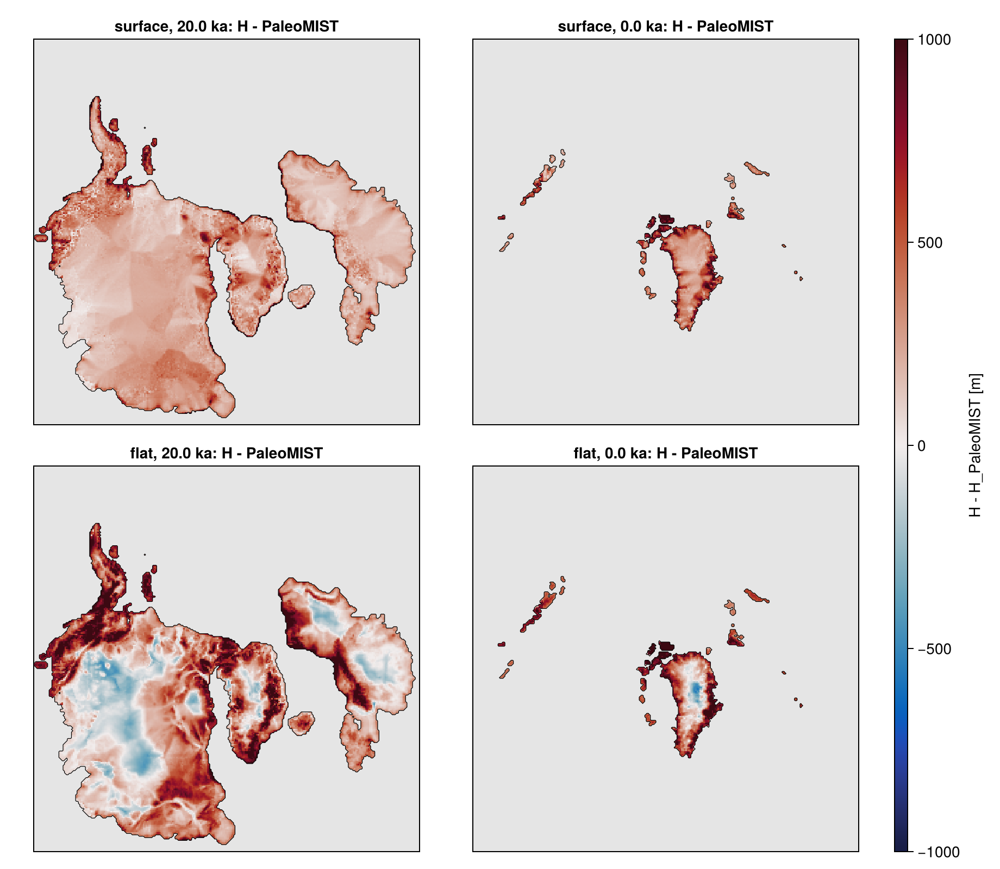
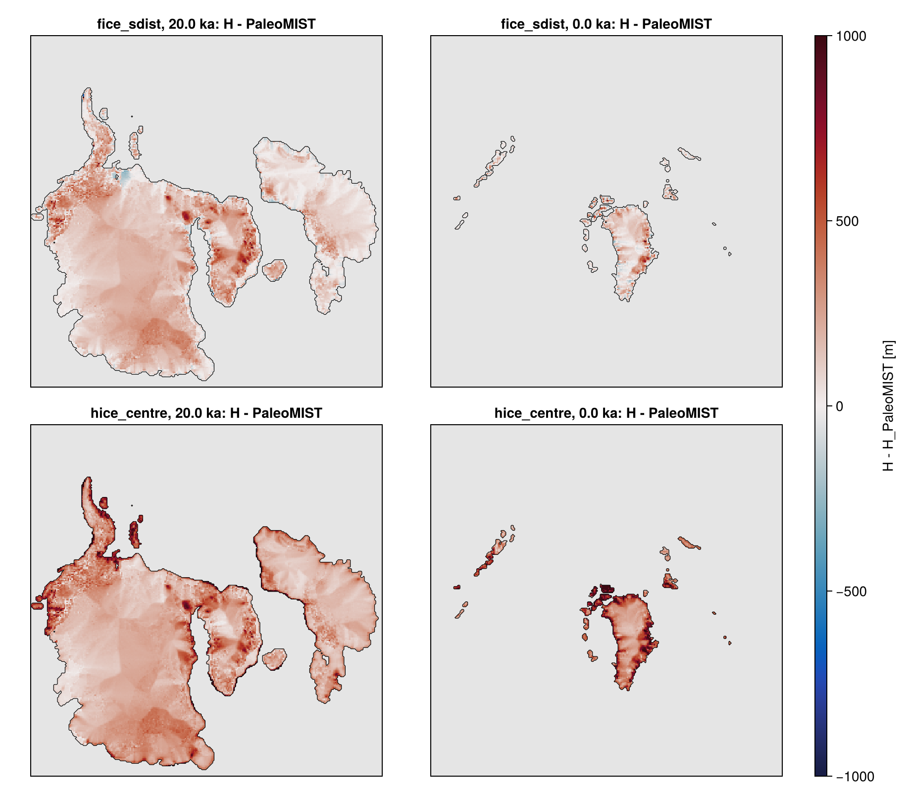
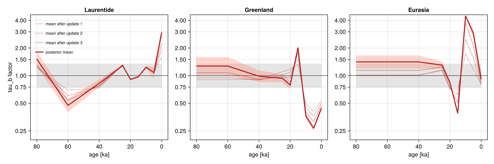
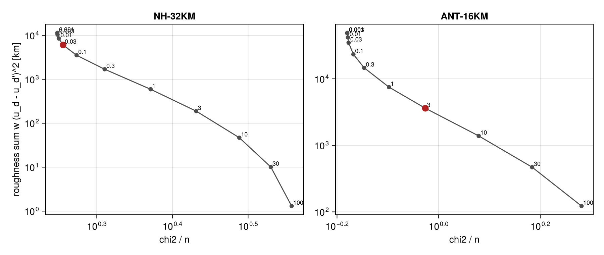
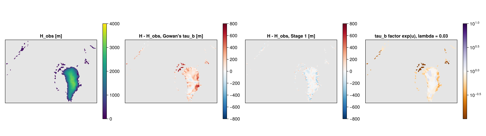
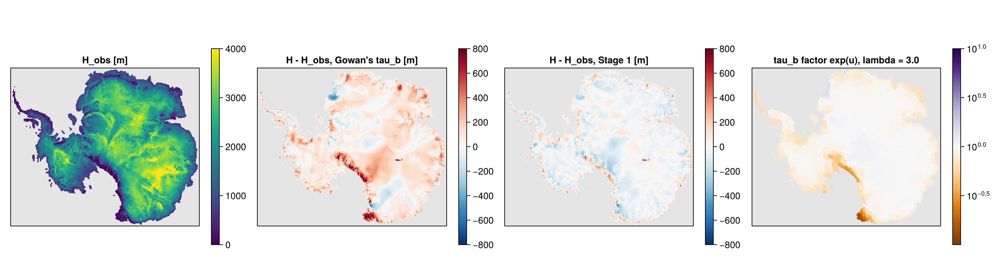
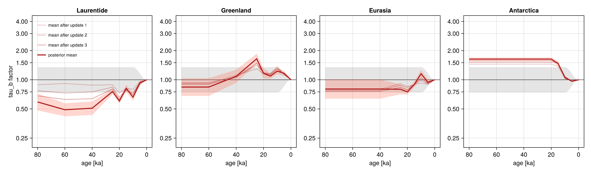

# ice backend `plastic`

A perfectly-plastic ice sheet as a kryos ice model, so that kryos reproduces Gowan et al. (2021) PaleoMIST
online: the margin chronology and the basal shear stress (tau_b) domains of PaleoMIST, and the bed and sea
level of the geo backend (VILMA2) at every coupling step. The solver is the Fortran library PlasticIceSheet
(module `plastic_ice`, `libplastic.a`, dp, no dependencies), the port of PlasticIceSheet.jl.

## Files

| File | What |
|---|---|
| `src/backends/ice/kryos_ice_plastic.f90` | the backend (`plastic_ice_t`), built with `plastic=1` |
| `src/backends/ice/kryos_ice_plastic_stub.f90` | the stub (`plastic=0`): the factory stops with "rebuild kryos with plastic=1" |
| `src/backends/ice/plastic/kryos_plastic_margin.f90` | the margin chronology: signed distance, interpolation (no library) |
| `src/backends/ice/plastic/kryos_plastic_taub.f90` | tau_b: const, gridded field, domains (no library) |
| `input/kryos_defaults.nml` `[ice_plastic]` | the keys of the instance group, with their defaults |
| `input/kryos-variables-ice-plastic.md` | the variables of the backend's own stream `plastic` |
| `par/kryos_North_plastic.nml` | NH-32KM, fixed bed (no geo) |
| `par/kryos_North_plastic_vilma2.nml` | NH-32KM with the global VILMA2 Earth of the science case (3-D) |
| `par/kryos_North_plastic_vilma2_b1.nml` | NH-32KM with VILMA2 on Gowan's 1-D Earth and B1's reference: the run scored against GAPSLIP beside B1 |
| `par/kryos_NH-ANT_plastic_vilma2_b1.nml` | as `_b1` with a second plastic instance on ANT-16KM (calibration v2) |
| `tests/test_plastic_margin.f90` | margin and tau_b (runs with `plastic=0`) |
| `tests/test_ice_plastic.f90` | the backend through the ice wrappers (`plastic=1` only) |
| `tests/plastic_slices.f90` | the offline check against PaleoMIST per slice (`plastic=1`) |
| `tests/plastic_taub_fit.f90` | Stage 1 of calibration v2: a tau_b factor per domain against the present-day thickness (`plastic=1`) |
| `tools/levante/plastic_maps.jl`, `plastic_score.sh` | maps of the offline check; the GAPSLIP scoring with `pm_compare.jl` (its `read_run` reads a kryos run's VILMA2 stream `geo_glob_vilma.nc` in place) |
| `tools/levante/plastic_taub_scale.jl`, `plastic_esmda.jl`, `plastic_esmda.sh`, `plastic_esmda.toml`, `plastic_esmda_v2.toml` | the tau_b calibration: scale groups and multiplier files; ES-MDA; its jobs; its configs (v1, v2) |
| `tools/levante/plastic_esmda_report.jl`, `plastic_taub_fit_report.jl`, `plastic_pd_regions.jl` | the reports: of a calibration; of Stage 1 (lambda, the domain factor file, maps); the present-day thickness per region |

Build: `plastic=1` adds `INC_PLASTIC` / `LIB_PLASTIC` (`config/common.mk`: the sibling `PlasticIceSheet`,
`libplastic/include` with `libplastic.a` and the `.mod` files; `make -C PlasticIceSheet static
config=dkrz_levante_ifx`). `yelmo=0` is enough for these runs. The library's API: PlasticIceSheet
`docs/fortran-port.md` (branch `fortran-port`).

## What a step does

`update(st)`, every ice step:

1. the bed `z_bed` and sea level `z_sl` from the imports (geo); until they are published (a domain without geo:
   always) the reference bed and `z_sl = 0`;
2. the ice mask at `t1` from the margin chronology (below);
3. tau_b at `t1` (below); every ice cell must have a positive tau_b, else the run stops naming the count;
4. `plastic_solve(ps, z_bed, z_sl, tau_b, mask, warm=.true., stat)` (`"surface"`: one sweep for z_s, warm
   ignored; `"full"`: warm-started from the last `w = H**2`) (`drive = "smb"`: `plastic_solve_smb` with the
   imported smb / rho_i, and tau_b the driving stress rho_i g H |grad z_srf| for the diagnostics);
   `stat = PLASTIC_NOT_CONVERGED` is a warning with the outer iteration count, the last change and the
   library's message, and the run goes on; `PLASTIC_BAD_INPUT` stops;
5. with `mass_balance = "implied"` (needs the rheology and the sliding law): the divergence of the steady
   solver's face fluxes on the new geometry, the outflow through the margin faces to land and to the ocean
   and the surface velocity of the same closure (`plastic_smb_flux_divergence`; "Implied mass balance" below);
6. the exports.

The ice is imposed, not integrated: no surface, basal or calving flux. The mass change the margin and the bed
impose is `mb_net`, so the budget of the global geo (and the sea level) closes.

## Exports (contracts-design 2.1)

| Export | Value |
|---|---|
| `H_ice`, `z_srf` | the solve (`z_srf`: the library's on the ice, `max(z_bed, z_sl)` elsewhere) |
| `z_bed`, `z_sl` | the bed and sea level the solve used |
| `f_ice` | 1 where H > 0 |
| `f_grnd` | 1 on the ice (plastic ice is grounded by construction), the flotation rule elsewhere |
| `dHidt` | (H - H_prev)/(t1 - t0), MEAN |
| `smb`, `cmb` | 0, or with `mass_balance = "implied"` the mass balance the geometry needs (below), MEAN |
| `bmb` | 0, MEAN |
| `mb_net` | rho_i dHidt [kg m-2 yr-1], MEAN |
| `M_ice` | rho_i sum(H) dx dy [Gt] |
| `H_grnd` | H - (rho_w/rho_i)(z_sl - z_bed) (as Yelmo's) |
| `footprint` | static: 1 where some margin slice has ice (every mask the interpolation gives lies in it) |
| `z_bed_ref`, `H_ice_pd` | static: the domain's reference bed and ice (present day) |
| `H_ice_ref` | the reference ice (present day), with the geometry (the row ice -> geo reads it at init) |
| `ux_s`, `uy_s` | `mass_balance = "implied"`: the surface velocity of the flux closure at the cell centres (diagnostic) |
| `smb_tot`, `cmb_tot` | `mass_balance = "implied"`: smb and cmb summed over the grid [Gt yr-1], MEAN |

`z_bed_ref`, `H_ice_ref` (rows ice -> geo, init), `footprint`, `H_ice_pd` and the flotation binding (the gather
of a host-resolved geo, `gia_check`) are what a geo backend needs from any ice; they are not specific to the
plastic model.

Flotation binding (`caps%has_flotation`): grounded where rho_i H >= rho_w (z_sl - z_bed), with the backend's
densities.

Own stream `plastic` (`out_plastic`, `<instance>_plastic.nc`, table `ice-plastic`): `H_ice`, `z_srf`, `z_bed`,
`z_sl`, `mask`, `sdist`, `tau_b`, `taub_domain` (domains), with `mass_balance = "implied"` `div_q`, `q_land`,
`q_marine` and the 0-D `abl_margin`, `discharge` [Gt yr-1], and the 0-D
`converged`, `n_outer_used` and the stress residual `stress_res_median`, `stress_res_max`
(`plastic_stress_residual`: |rho_i g H |grad z_srf| - tau_b| / tau_b over the ice, cell-centred, so 1 at the first
ice cell by construction) of the last solve, computed when the stream is written.

## Implied mass balance

`mass_balance = "implied"`: the mass balance the reconstructed geometry needs, from the flux of a flow closure
(Glen's law `rheo_A`, `rheo_n` and a sliding law `slide_*`). The flux is the membrane-free DIVA flux of the
library's steady SMB-driven solver, q = -H (u_b(tau) + 2A/(n+2) tau^n H) grad s / |grad s|, tau = rho_i g H
|grad s|, on staggered faces, with a one-sided flux from the last ice cell to the margin
(`plastic_smb_flux_divergence`, PlasticIceSheet `docs/fortran-port.md`). After each solve: div q per ice cell
and the outflow through its margin faces, `q_land` where the ice-free neighbour's bed is above sea level,
`q_marine` where it is below (both >= 0; their sum over the grid equals that of div q). The exports, MEAN over
the step [kg m-2 yr-1]:

- on the ice: smb = rho_i (dHidt + div q - q_land) (the outflow to land ablated in the margin cell: a sub-grid
  ablation zone), cmb = -rho_i q_marine (calving);
- on the cells the ice left over the step: their loss rho_i dHidt, as cmb where the bed lies below sea level,
  else as smb;
- so smb + cmb summed over the grid is mb_net (the mass change the margin and the bed impose); `smb_tot`,
  `cmb_tot` the sums [Gt yr-1].

div q and the outflow are those of the geometry at t1. With drive = "taub" the driving stress of the face fluxes is
capped at tau_b (the face: the mean of its cells; a margin face: its ice cell): a plastic bed carries at most its yield
stress, and the steep step from the ice to the margin surface otherwise drives the outflow of the margin cells far above
the stress of the ice (the marine margin cells of the first coulomb_n fit had 10 times the implied SMB of the interior). With `mb_smooth_km` > 0, div q - q_land is smoothed over the ice by a
Gaussian of that sd, in scatter form (each cell spreads its value over the ice cells within 3 sd, weights normalised
by their sum), which keeps its sum: the plastic surface is piecewise (steps at the tau_b domain boundaries, kinks
along the flowlines of the eikonal solve), and its flux divergence at the grid scale is mostly that, while ice
averages the stress over a few thicknesses. The magnitude scales with the closure (A, sliding): the
implied mass balance is what this geometry needs with that flow law, not a climate. `ux_s`, `uy_s`: the
surface velocity of the same closure, u_b(tau) + 2A/(n+1) tau^n H along -grad s (central slopes), for the
comparison with observed speeds.

`slide_law = "yield"`: u_b = u_y (tau / tau_b)^m with tau_b the imposed basal shear stress (the yield stress of the plastic bed)
and u_y = `slide_uy` (tau_b / 100 kPa)^`slide_uy_b`: the library's Weertman law with a beta per cell, beta = tau_b / u_y^(1/m),
set from tau_b every step. Plastic ice sits at tau close to tau_b, so u_y is its sliding speed, and `slide_uy_b` < 0 makes a weak
bed fast (ice streams on the low-tau_b shelf domains). A uniform beta does the opposite: at 10 kPa (Gowan's shelf domains, every
Antarctic margin cell at 20 kyr) Weertman with beta = 3e4 slides at 0.04 m/yr, and the LGM Antarctic discharge of the first test
was 200 Gt/yr against 5000 today. The velocity-routing path (`plastic_velocity`, `plastic_smb_implied`) is not
used.

Why the closure needs sliding that rises towards the margin: in a plastic sheet the driving stress is tau_b, so the
deformation flux 2A/(n+2) tau_b^n H^2 falls from the divide outwards, and with "yield" at `slide_uy_b` = 0 the sliding
speed is u_y everywhere; q ~ H then falls along every flowline and the implied SMB is negative almost everywhere
but at the divides. A steady flowline needs u = q/H to rise 10-20 times from the divide to the equilibrium line.

`slide_law = "coulomb_n"`: the library's regularised Coulomb law, tau = C (u_b/(u_b + u_0))^(1/m), with
C = tau_b lambda N / (rho_i g `slide_Hc`) per cell, set every step:
- N = rho_i g H (1 - H_f/H)^`slide_p` the effective pressure (Leguy et al. 2014), H_f = rho_w/rho_i max(0, z_sl - z_bed)
  the flotation thickness, 0 at or below it;
- lambda(z_bed - z_sl) linear from `slide_lambda_min` at `slide_zb0` or lower to 1 at `slide_zb1` or higher (weak
  marine sediments, ice streams in the troughs).

At tau = tau_b the sliding speed is u_0 x/(1 - x), x = (`slide_Hc` rho_i g / (lambda N))^m, at most `slide_umax` (where
C <= tau): it depends on N and the bed alone, so the tau_b domains enter through the geometry, not the speed. On land
(N = rho_i g H) the ice slides slowly under thick ice and fast where it thins below `slide_Hc` / lambda; near flotation
N goes to 0 (fast marine margins). C proportional to tau_b keeps hard beds (high tau_b, thick ice, high N) slow;
C = c_f lambda N alone would make them faster.

`mass_balance = "inverted"` (drive = "taub"; docs/dev/plastic-smb-inversion-design.md): at each update, on the geometry at
t1, the library's joint inversion (plastic_smb_inversion) of the depth-averaged speed per ice cell (along the plastic flow
direction) and the mass balance a = dHidt + div q - q_land (upwind face speed, the face geometry of the steady fluxes),
minimising the misfit of ln(speed) to the closure's speed at tau capped at tau_b (`inv_sigma_u`, smoothness over
`inv_smooth_km`) and of a to the imported smb, the prior (`inv_sigma_smb_rel`, `inv_sigma_smb_min`, the deviation smooth over
`inv_smooth_smb_km`: a spatially correlated prior error), with a penalty on
a < 0 where the prior is >= 0 off the margin (`inv_cold`, `inv_sigma_cold`) and the speed at least the deformation speed
(no negative sliding). smb = rho_i a and cmb = -rho_i q_marine on the ice, as "implied" (no `mb_smooth_km`); ux_s, uy_s
the speed plus u_def/(n+1) along the flow direction. The prior comes from a surface instance of the domain (e.g.
`smb_simple`): a rough first estimate, so its sd is large.

`taub_smooth_km` (default 50; drive = "taub"): tau_b at t, after the factors, is replaced on the cells with tau_b > 0
by its Gaussian mean over them (sd `taub_smooth_km`, within 3 sd; a normalised convolution), for the solve and the
closure alike: the domain steps become ramps of a few sd (the ice averages the basal stress over several
thicknesses), the value of a uniform region is kept. 0 = none.

## Margin chronology

The slices of `margin_var` (default `f_ice`) in `margin_file` (`{domain}`, `{grid_name}` replaced, as
`recon_path`), on the instance grid, with ice where the variable exceeds `margin_H_min` (a fill value is no
ice). The time axis is converted to model time from its units: `years ago` and `BP` count into the past, a
leading `k` is thousands of years (the FesmData PaleoMIST product `{grid}_IceHistory-PaleoMIST.nc`: 33
slices, 80 ka to present, `years ago`).

At init every slice becomes its signed distance to the margin, in m, positive inside: the exact Euclidean
distance between cell centres (separable transform, Felzenszwalb and Huttenlocher), from an ice cell to the
nearest ice-free cell and vice versa, less half a cell so that the zero level lies midway between them and
`sd > 0` is the slice again. A slice without ice (or without ice-free cells) has the domain diagonal.

At time t, `margin_interp`:

- `"sdist"` (default): the signed distance interpolated linearly between the two slices that bracket t; the
  mask is `sd > 0`. The margin migrates smoothly and linearly in time (two concentric disks: the radius is
  linear in t, tested), the slices come back exactly at their times, and a cell is ice only where one of the
  two slices has ice.
- `"nearest"`: the nearest slice (a tie keeps the earlier one): Gowan's offline behaviour, for comparison.

Position within the cells (`margin_position`, the library's `margin_frac`, PlasticIceSheet docs/fortran-port.md
"Margin position"): `"sdist"` (default) places the margin on each ice-free cell next to the ice at -sd / sqrt(dx dy) of
the spacing from its centre (`plastic_margin_frac_from_sdist`, clamped to [0, 0.99]), with sd the interpolated signed
distance (positive in the ice, m, cell centres: the library's convention). sd is the centre-to-centre distance to the
nearest opposite cell less half a cell, so at a slice's time it is the distance to the staircase of cell faces and the
margin lies at the faces (0.5); between the slices it moves within the cells, linearly in time. `"face"` and `"centre"`
(the ice-free cell centre, PlasticIceSheet.jl and this backend until 2026-11-09) set `par%margin` and pass no fraction.

Which variable: PaleoMIST's `H_ice` is Gowan's thickness smoothed with a 25 km Gaussian filter, so `H_ice > 1 m`
reaches beyond his margin, and the plastic ice there makes the NH volume too large (most of the 15-50 % excess
below). The product's `f_ice` is the ice fraction of the unsmoothed 5 km reconstruction on each cell, and
`f_ice > 0.5` is Gowan's margin at the grid's resolution: the default. `margin_var = "H_ice"`, `margin_H_min = 1` keeps
the earlier margin (the results below until 2026-11-09 used it).

Outside the slices' time range: stop (`margin_extrapolate = "error"`), or hold the first or last slice
(`"hold"`; also for a tau_b series).

## tau_b

`taub_method`:

- `"const"`: `taub_const` [Pa] everywhere;
- `"file"`: the static field `taub_var` (x, y) [Pa] of `taub_file`;
- `"domains"` (Gowan's): the product `{grid}_IceHistory-PaleoMIST_taub.nc` (FesmData, not yet merged):
  `taub_domain_var` (x, y) the domain id of each cell (<= 0 = none; the product: -9999), `taub_id_var` (n) the ids, `taub_value_var` (n) their tau_b
  [Pa], and, when the file has it, `taub_time_var` (n, time; either dimension order) a series per id, linear
  in time. The group named by `taub_override` (keys `codes`, `taub`, as the `till_cf` group of the yelmo
  backend) sets the value of some ids, constant in time, or gives an id of the map the file has no value for;
  an id of the map without a value stops at init. Cells without a domain take `taub_default` (0 = none: such
  a cell in the ice mask stops the run).

The product (949 domains, all regions in every file): `domain_id` = region*1000 + Gowan's id, `taub` (Gowan's
domains_max), `taub_t` (time, domain) in NetCDF order, years ago, 80 ka to 0, oldest first: tau_b is time
dependent in PaleoMIST 1.0, so the series is used, linear between its records. Ids 1000, 2000, 3000 are Gowan's
domains outside every polygon (5000 Pa); cells without a domain take `taub_default` (the par files: 5000 Pa).
Its 2-D base field `taub_map` can be read with `taub_method = "file"`.

`taub_domain_factor_file` (`"domains"` only; `""` = none): a factor per domain, constant in time (the present-day fit, Stage 1 of
calibration v2 below). NetCDF, dimension `domain`: `domain_id(domain)`, `log_factor(domain)` (natural log of the factor). tau_b of a
domain is its value (the series, after the override table) times exp(log_factor), then times the scale groups' multiplier below; the
`taub_default` of the cells without a domain is not scaled; an id of the product missing from the file keeps factor 1; an id of the
file without tau_b stops unless its log_factor is 0 (one file can hold the domains of all grids). A file of zeros gives tau_b bit for
bit (tested).

`taub_scale_file` (`"domains"` only; `""` = none): multipliers of tau_b per scale group, time dependent (the calibration
below). NetCDF, dimensions `domain`, `scale_group`, `node`: `domain_id(domain)`, `group(domain)` (the scale group of each id,
1 to the number of groups, 0 = unscaled), `time(node)` (any order, its units as the margin's: `years ago`, ...),
`log_factor(scale_group, node)` (natural log of the multiplier). tau_b of a domain is its value (the series, after the
override table) times exp(log_factor of its group at t), log_factor linear in time between the nodes and held outside them;
the `taub_default` of the cells without a domain is not scaled. An id of the product missing from the file is unscaled; an id
of the file with a group but no tau_b stops. Init logs the number of groups, of scaled domains and nodes and the factor range.
Without the key the backend is unchanged (bit for bit, below).

## Passes (core-design 3.2)

| Pass | What the backend does |
|---|---|
| `PASS_INIT` | the first solve at `time_init` on the reference bed (`z_sl = 0`: no import is published yet), cold (`warm = .false.`); the static exports, the geometry and `M_ice` |
| `PASS_GEOMETRY` | the solve on the bed and sea level geo gave (cold start block a; with a host-resolved geo again in block c', on the spun-up Earth) and the geometry |
| `PASS_SPINUP` | the MEAN exports of the virtual previous step: no change (0), as Yelmo's equilibrium-free start |
| `PASS_RESTART` | after `restart_read` (H, w, H_prev, z_srf) and the core's restore of imports and exports: the inputs of the restored time (bed, sea level, mask, tau_b) and the diagnostics `ux_s`, `uy_s`; no state export |
| others | nothing |

`prepare` is not implemented (the default): the backend reads its imports in `update`, so an experiment hook
cannot change them (no experiment works on this backend).

Restart: `<instance>_restart.nc` with `H`, `w`, the mask `w` belongs to and whether it is usable (the
library's warm-start state, `ps%wk%mask_prev`, `ps%has_warm`, so that a restarted `"full"` solve starts as the
continuous one), `H_prev` and `z_srf`, lossless; the read checks the grid and the time.

## Keys (`[ice_plastic]`)

| Key | Default | |
|---|---|---|
| `drive` | `"taub"` | `"taub"` or `"smb"` (needs `rheo_A`, `slide_law`) |
| `mode` | `"surface"` | passed to the library as it is: `"surface"` (the plastic surface equation for z_s, one monotone sweep, with the bed), `"flat"` (no bed slope), `"full"` (w = H**2 with the bed slope by a fixed point; does not converge on 32 km beds) |
| `relax`, `warm_frac_max`, `n_outer`, `max_sweeps`, `tol`, `outer_tol` | 0.5, 0.1, 100, 200, 1e-6, 1e-3 | the library's iteration controls |
| `rho_i` | 910 | [kg m-3] the kryos `Earth` constant and the PaleoMIST runs (library default 917) |
| `rho_w`, `g` | 1028, 9.81 | the kryos `Earth` constants (library defaults 1025, 9.80665) |
| `H_min` | 1 | [m] floor of H inside the mask |
| `margin_file`, `margin_var`, `margin_H_min` | `""`, `"f_ice"`, 0.5 | the margin slices: ice where `margin_var` > `margin_H_min` (`"H_ice"`, 1 m: the smoothed thickness) |
| `margin_interp`, `margin_extrapolate` | `"sdist"`, `"error"` | see above |
| `margin_position` | `"sdist"` | the margin within the cells (below): `"sdist"`, `"face"`, `"centre"` |
| `taub_method`, `taub_const` | `"const"`, 0 | |
| `taub_file`, `taub_var` | `""`, `"taub"` | `"file"` |
| `taub_domain_file`, `taub_domain_var`, `taub_id_var`, `taub_value_var`, `taub_time_var` | `""`, `"taub_domain"`, `"domain_id"`, `"taub"`, `"taub_t"` | `"domains"` |
| `taub_override`, `taub_default` | `""`, 0 | `"domains"` |
| `taub_domain_factor_file` | `""` | `"domains"`: the factor per domain (above), before the scale groups |
| `taub_scale_file` | `""` | `"domains"`: the multipliers per scale group (above) |
| `taub_smooth_km` | 50 | `drive = "taub"`: Gaussian sd [km] of the smoothing of tau_b over the cells with tau_b > 0 (above); 0 = none |
| `rheo_A`, `rheo_n` | 0, 3 | Glen rate factor [Pa-n yr-1] (0: no closure), exponent |
| `slide_law` | `"none"` | `"linear"`, `"weertman"` (`slide_beta`, `slide_m`), `"coulomb"` (`slide_C`, `slide_u0`, `slide_m`), `"yield"` (`slide_uy`, `slide_uy_b`, `slide_m`; `drive = "taub"`), `"coulomb_n"` (`slide_Hc`, `slide_lambda_min`, `slide_zb0`, `slide_zb1`, `slide_p`, `slide_u0`, `slide_m`, `slide_umax`; `drive = "taub"`) |
| `slide_umax` | 0 | [m yr-1] `"coulomb"`, `"coulomb_n"`: the speed cap where tau reaches C (0 = none; `"coulomb_n"` needs one) |
| `inv_sigma_u`, `inv_smooth_km` | 0.7, 0 | `"inverted"`: sd of ln(speed) about the closure's; length [km] of the smoothness of its correction |
| `inv_smooth_smb_km` | 50 | `"inverted"`: length [km] of the smoothness of the deviation of a from the prior |
| `inv_sigma_smb_rel`, `inv_sigma_smb_min` | 0.5, 100 | `"inverted"`: sd of a about the prior, relative and floor [kg m-2 yr-1] |
| `inv_cold`, `inv_sigma_cold`, `inv_n_iter` | .true., 10, 50 | `"inverted"`: the penalty on a < 0 where the prior is >= 0 [kg m-2 yr-1]; Gauss-Newton steps |
| `mb_smooth_km` | 0 | `"implied"`: Gaussian sd [km] of the conservative smoothing of div q - q_land over the ice (sums unchanged; 0 = none) |
| `mass_balance` | `"none"` | `"implied"`: smb, cmb, smb_tot, cmb_tot, ux_s, uy_s from the flux closure (needs `rheo_A`, `slide_law`); `"inverted"`: by the joint inversion (above; needs the smb import too) |
| `out_plastic` | `"none"` | schedule of the stream `plastic` |

A density other than the run's `rho_ice` / `rho_sw` is logged as a warning: the ice mass the globe gathers for
VILMA2 is the export `H_ice` times the run's `rho_ice`.

## Imports

`z_bed`, `z_sl` (optional: the reference bed and 0 until published); `smb` only with `drive = "smb"` (then
required); `T_srf`, `bmb_shlf` are not read and may stay unwired, so a domain needs no climate, surface or
shelf.

## Tests

- `tests/test_plastic_margin.f90` (any build): the distance transform against brute force (dx /= dy); the
  signed distance of a slice; two disks: the slices at their times, the margin within one cell of the linear
  radius at nine times, the area halfway, the footprint, `nearest`; a margin file in `kyr BP` with a fill
  value; hold and the stop outside the range; tau_b domains (static, override, a series in either dimension
  order, an id added by the table, the stops); the tau_b scale (groups by id, an id added by the table, linear in
  time between unordered nodes, held outside, times the series, the default unscaled, factor 1 bit for bit, the
  stops); the domain factor (by id, times the series and then the scale groups, constant in time, the default unscaled, a file
  of zeros bit for bit with and without the scale, the stop for a scaled id without tau_b).
- `tests/test_ice_plastic.f90` (`plastic=1`): the backend on a toy grid (flat bed, two disks, tau_b const,
  `mode = "flat"`): the plastic profile at the centre, the masks, the static exports, an update (dHidt,
  mb_net, M_ice), a restart round trip stepped on bit for bit, the flotation binding.
- `tests/test_build.f90`: the factory admits `plastic` when linked.

## Results (Levante, 2026-11-09)

Build: kryos `plastic=1 yelmo=0 vilma=1` (stack S11 dependencies) against PlasticIceSheet `fortran-port`
(`/work/ba1442/robinson/PlasticIceSheet-fortran/ifx`); runs in `/work/ba1442/robinson/kryos-ice-plastic/runs`.
tau_b: `NH-32KM_IceHistory-PaleoMIST_taub.nc` (FesmData IceHistory v2.3.0),
domains with the time series, `taub_default` 5000 Pa; the margin `H_ice` > 1 m (the default is now `f_ice` > 0.5).

**Fixed bed** (`par/kryos_North_plastic.nml`: today's bed, z_sl = 0, 80 ka -> 0, dtt = 100 yr, 800 solves): 25 s on
4 cores; `"surface"` 10 ms, `"flat"` 4 ms per solve; every solve converged; the ice mask is PaleoMIST's (H > 1 m) at
every slice. Restart (flat, tau_b const): the 40 ka bundle continued to 0 equals the continuous run bit for bit
(1284 variables and records).

The fixed-bed, offline and online results in this section up to "Baseline" used the margin `H_ice` > 1 m at the
ice-free cell centres (the library before `margin_frac`).

**Offline check** (`tests/plastic_slices.f90`): at each of the 33 slices PaleoMIST's own bed (relative to the sea
level of the time, so z_sl = 0), its margin, Gowan's tau_b of that time, a cold solve, against its `H_ice` over its
ice. Volume in m SLE (rho_i/rho_sw = 910/1028, 3.618e14 m2 ocean):

| mode | bias [m] | rms [m] | stress residual median | 80 ka | 65 ka | 45 ka | 20 ka | 0 ka |
|---|---|---|---|---|---|---|---|---|
| PaleoMIST | | | | 12.9 | 53.7 | 40.6 | 112.5 | 7.5 |
| surface | +257 to +502 | 309 to 558 | 0.025 to 0.14 | 18.7 | 65.6 | 49.2 | 130.0 | 10.5 |
| flat | +285 to +550 | 425 to 650 | 0.39 to 0.83 | 19.2 | 67.7 | 50.4 | 132.6 | 10.6 |
| full (none converged) | -196 to +306 | 355 to 580 | | 16.6 | 57.8 | 44.0 | 100.1 | 8.6 |

`"surface"` solves the plastic equation (median stress residual 3 %, the maximum 1 at the first ice cells), and
still makes the ice 260-500 m thicker than PaleoMIST, the NH volume 15-50 % larger. The misfit is broad and
positive over the interiors, larger towards the margins and on the Arctic islands, and Greenland is +300 m today
(figure: `"surface"` top, `"flat"` bottom, 20 ka and 0 ka). Not the solver then: tau_b (values, units or how
ICESHEET uses them), the resolution (Gowan: 5 km, PaleoMIST smoothed to 25 km) or the margin. The unconverged
`"full"` result being closer is not evidence (no fixed point).



**Online with VILMA2** (`par/kryos_North_plastic_vilma2_b1.nml`, mode `"surface"`: Gowan's 1-D Earth, lmax 170, B1's
reference; NH-32KM plastic, the rest of the world PaleoMIST's history; Earth and ice step 100 yr): 7 min 25 s on 64
threads (shared partition), of which init and VILMA2's relaxation to the 80 ka load about 2 min and the 800 steps
333 s, 4.2 s per simulated kyr (VILMA2 221 s, output 101 s, plastic 8 s). H against PaleoMIST: bias +283 to +450 m,
volume 1.18 to 1.51 (as the offline check). ESL (`bsl_ive` - `bsl_ive`(0), m):

| ka | 80 | 65 | 60 | 45 | 30 | 22.5 | 20 | 15 | 10 | 5 |
|---|---|---|---|---|---|---|---|---|---|---|
| PaleoMIST | -10.0 | -51.1 | -78.6 | -38.4 | -61.7 | -110.9 | -115.6 | -81.0 | -29.3 | -5.0 |
| I910_it0 (B1 at 910) | -10.2 | -52.6 | -82.4 | -39.2 | -63.8 | -117.8 | -122.8 | -84.5 | -29.5 | -5.1 |
| online plastic | -12.5 | -61.4 | -94.4 | -44.7 | -72.4 | -131.7 | -137.7 | -96.2 | -34.0 | -5.2 |

GAPSLIP 2.1 indicators (`tools/levante/plastic_score.sh`: `pm_compare.jl` with the run's VILMA2 stream beside B1,
the same scoring as docs/dev/vilma2-paleomist.md; RMS z, median |z|, fraction |z| <= 2, mean misfit [m], marine /
terrestrial limiting data violated):

| set | model | RMS z | median abs(z) | abs(z) <= 2 | mean d | ML viol. | TL viol. |
|---|---|---|---|---|---|---|---|
| all | PaleoMIST | 29.5 | 4.42 | 0.30 | 1.5 | 0.45 | 0.30 |
| | B1_l170 | 30.4 | 4.41 | 0.30 | 2.9 | 0.42 | 0.30 |
| | I910_it0 | 30.3 | 4.36 | 0.31 | 3.2 | 0.42 | 0.30 |
| | online plastic | 25.5 | 4.03 | 0.32 | 1.1 | 0.41 | 0.36 |
| Laurentide | B1_l170 | 9.6 | 5.32 | 0.19 | 1.3 | 0.25 | 0.25 |
| | online plastic | 9.8 | 4.73 | 0.28 | 4.3 | 0.19 | 0.31 |
| Greenland | B1_l170 | 110.6 | 9.28 | 0.09 | -15.1 | 0.60 | 0.02 |
| | online plastic | 88.9 | 9.22 | 0.07 | -19.4 | 0.58 | 0.02 |
| Fennoscandia/Barents | B1_l170 | 16.5 | 5.82 | 0.27 | 3.8 | 0.26 | 0.44 |
| | online plastic | 14.6 | 4.82 | 0.28 | 2.9 | 0.23 | 0.52 |
| far field | B1_l170 | 16.0 | 3.23 | 0.39 | 5.1 | 0.44 | 0.18 |
| | online plastic | 15.3 | 3.07 | 0.38 | 1.4 | 0.47 | 0.17 |

The online run scores as well as B1 or better on most sets with 15-20 % more NH ice; the terrestrial limiting
data are violated more often (the sea level too high where the ice is too thick). Differences to B1 besides the
ice: the run's densities (910, 1028; B1 931, 1000), today's GEBCO bed on NH-32KM instead of PaleoMIST's 0 ka bed,
the 100-yr coupling.

PaleoMIST's ice area by threshold (NH-32KM, 1e6 km2; `H > 0`, `> 1 m`, `> 10 m`): 80 ka 5.55, 4.94, 4.60; 65 ka
16.31, 15.66, 15.30; 45 ka 12.05, 11.46, 11.08; 20 ka 28.33, 27.66, 27.23; 0 ka 3.13, 2.66, 2.42; the threshold moves
the plastic volume by about 10 % (flat, 80 ka: 21.6, 19.2, 17.9 m SLE).

**Baseline** (2026-11-09, restored PaleoMIST files; margin `f_ice` > 0.5, `margin_position = "sdist"`, the library
with `margin_frac`). Offline check, `"surface"`, volume [m SLE] by margin variable and position (at the slices `"sdist"` is
`"face"`):

| margin | bias [m] | rms [m] | volume / PaleoMIST | 80 ka | 65 ka | 45 ka | 20 ka | 0 ka |
|---|---|---|---|---|---|---|---|---|
| PaleoMIST | | | | 12.9 | 53.7 | 40.6 | 112.5 | 7.5 |
| `f_ice` > 0.5, sdist | +88 to +166 | 146 to 204 | 1.07 to 1.10 | 13.8 | 58.1 | 43.5 | 122.4 | 8.0 |
| `f_ice` > 0.5, centre | +171 to +244 | 211 to 292 | 1.10 to 1.17 | 14.9 | 60.2 | 45.0 | 124.3 | 8.6 |
| `H_ice` > 1 m, sdist | +225 to +386 | 273 to 440 | 1.14 to 1.39 | 17.4 | 63.4 | 47.6 | 128.3 | 9.8 |
| `H_ice` > 1 m, centre (before) | +257 to +502 | 309 to 558 | 1.16 to 1.50 | 18.7 | 65.6 | 49.2 | 130.0 | 10.5 |

The margin variable takes most of the excess, the position within the cells the rest of the half cell: 7-10 % more
volume than PaleoMIST remain (the native-grid check of the library: 5-7 % at 30 km is the resolution). The misfit is
positive and broad, larger near the margins; the patch at the head of Baffin Bay persists, smaller: at 20 ka 18 cells
over +500 m (max +936 m at 77.5 N 65.8 W, the Greenland side of Smith Sound) against 87 with the old margin
(max +1082 m); 6 cells over +500 m in the Canadian Arctic today (max +894 m, northern Ellesmere).



Online with VILMA2 (`par/kryos_North_plastic_vilma2_b1.nml`, run `runs/vilma2-b1-fice`): 13.6 min on 16 threads (3 runs
on a node). ESL [m]:

| ka | 80 | 65 | 60 | 45 | 30 | 22.5 | 20 | 15 | 10 | 5 |
|---|---|---|---|---|---|---|---|---|---|---|
| PaleoMIST | -10.0 | -51.1 | -78.6 | -38.4 | -61.7 | -110.9 | -115.6 | -81.0 | -29.3 | -5.0 |
| I910_it0 (B1 at 910) | -10.2 | -52.6 | -82.4 | -39.2 | -63.8 | -117.8 | -122.8 | -84.5 | -29.5 | -5.1 |
| online plastic, old margin | -12.5 | -61.4 | -94.4 | -44.7 | -72.4 | -131.7 | -137.7 | -96.2 | -34.0 | -5.2 |
| online plastic, baseline | -10.1 | -55.7 | -88.8 | -41.4 | -67.2 | -125.4 | -131.7 | -92.3 | -32.6 | -5.0 |
| v2 baseline (Stage 1 factors, NH + ANT plastic) | -9.3 | -53.0 | -83.6 | -39.4 | -64.2 | -119.2 | -124.8 | -86.7 | -30.5 | -4.4 |

GAPSLIP 2.1 (as above):

| set | model | RMS z | median abs(z) | abs(z) <= 2 | mean d | ML viol. | TL viol. |
|---|---|---|---|---|---|---|---|
| all | PaleoMIST | 29.5 | 4.42 | 0.30 | 1.5 | 0.45 | 0.30 |
| | B1_l170 | 30.4 | 4.41 | 0.30 | 2.9 | 0.42 | 0.30 |
| | I910_it0 | 30.3 | 4.36 | 0.31 | 3.2 | 0.42 | 0.30 |
| | online, old margin | 25.5 | 4.03 | 0.32 | 1.1 | 0.41 | 0.36 |
| | online, baseline | 25.9 | 3.95 | 0.34 | 1.8 | 0.39 | 0.33 |
| | v2 baseline | 26.7 | 3.93 | 0.34 | 2.7 | 0.42 | 0.35 |
| Laurentide | PaleoMIST | 9.0 | 4.13 | 0.26 | 2.9 | 0.20 | 0.28 |
| | B1_l170 | 9.6 | 5.32 | 0.19 | 1.3 | 0.25 | 0.25 |
| | I910_it0 | 9.4 | 5.12 | 0.20 | 1.3 | 0.25 | 0.24 |
| | online, old margin | 9.8 | 4.73 | 0.28 | 4.3 | 0.19 | 0.31 |
| | online, baseline | 9.4 | 4.72 | 0.28 | 3.0 | 0.21 | 0.28 |
| | v2 baseline | 9.4 | 4.65 | 0.29 | 3.3 | 0.20 | 0.28 |
| Greenland | PaleoMIST | 107.1 | 11.12 | 0.04 | -22.2 | 0.69 | 0.01 |
| | B1_l170 | 110.6 | 9.28 | 0.09 | -15.1 | 0.60 | 0.02 |
| | I910_it0 | 110.2 | 9.60 | 0.09 | -15.3 | 0.60 | 0.02 |
| | online, old margin | 88.9 | 9.22 | 0.07 | -19.4 | 0.58 | 0.02 |
| | online, baseline | 91.7 | 10.21 | 0.14 | -12.4 | 0.52 | 0.02 |
| | v2 baseline | 94.5 | 14.35 | 0.06 | -26.4 | 0.67 | 0.03 |
| Fennoscandia/Barents | PaleoMIST | 19.9 | 7.80 | 0.17 | 6.4 | 0.32 | 0.41 |
| | B1_l170 | 16.5 | 5.82 | 0.27 | 3.8 | 0.26 | 0.44 |
| | I910_it0 | 16.2 | 5.55 | 0.28 | 3.4 | 0.25 | 0.44 |
| | online, old margin | 14.6 | 4.82 | 0.28 | 2.9 | 0.23 | 0.52 |
| | online, baseline | 13.2 | 4.30 | 0.32 | 1.8 | 0.23 | 0.49 |
| | v2 baseline | 13.5 | 4.18 | 0.31 | 2.1 | 0.21 | 0.53 |
| Antarctica | PaleoMIST | 9.8 | 5.48 | 0.15 | 7.8 | 0.68 | 0.26 |
| | B1_l170 | 9.8 | 3.56 | 0.19 | -0.6 | 0.71 | 0.17 |
| | I910_it0 | 10.3 | 3.53 | 0.26 | -1.0 | 0.72 | 0.17 |
| | v2 baseline | 16.0 | 2.55 | 0.38 | -1.9 | 0.74 | 0.11 |
| far field | PaleoMIST | 13.6 | 2.85 | 0.41 | 1.3 | 0.46 | 0.16 |
| | B1_l170 | 16.0 | 3.23 | 0.39 | 5.1 | 0.44 | 0.18 |
| | I910_it0 | 16.1 | 3.20 | 0.39 | 6.0 | 0.44 | 0.20 |
| | online, old margin | 15.3 | 3.07 | 0.38 | 1.4 | 0.47 | 0.17 |
| | online, baseline | 15.4 | 3.14 | 0.39 | 3.1 | 0.45 | 0.17 |
| | v2 baseline | 16.2 | 3.10 | 0.40 | 6.0 | 0.43 | 0.18 |

The baseline ESL is 14 % above PaleoMIST's at 20 ka (old margin 19 %, I910_it0 6 %); it scores better than B1 on every NH
set but RMS z of Greenland (dominated by a few points, below) and violates fewer terrestrial limiting data than the old
margin.

Checks on the restored files: the baseline with `taub_scale_file = ""` and without the key give the same output, every
file bit for bit; `margin_position = "centre"` with the new library and the old margin (`H_ice` > 1 m) gives the old
binary's ice bit for bit, and VILMA2's sea-level diagnostics (`bsl`, `mass_resid`) and the stress residual to 2e-14.

## Calibration of tau_b (ES-MDA)

Gowan tuned tau_b by hand against RSL and GIA data; here per-group, time-dependent multipliers on his tau_b are calibrated
online, VILMA2 in the loop, against the GAPSLIP 2.1 sea-level index points, by an ensemble smoother with multiple data
assimilation (ES-MDA, Emerick and Reynolds 2013). Tools in `tools/levante`: `plastic_esmda.toml` (the config),
`plastic_taub_scale.jl` (groups, multiplier files), `plastic_esmda.jl` (init, scoring, update), `plastic_esmda.sh` (the jobs).

**Parameters**: theta = the log multipliers of 3 groups x 9 nodes (80, 60, 40, 25, 20, 15, 10, 5, 0 ka) = 27, linear in time
between the nodes (`taub_scale_file`). Groups (`[[scale.groups]]`, by Gowan's region of the domain): Laurentide (region 1 without
Greenland; 101 domains with cells on NH-32KM, 24771 cells), Greenland (109, 3830), Eurasia (region 2; 159, 10075); Antarctica is
not calibrated (no cells on NH-32KM). Greenland: a region-1 domain whose cells on the grid lie more than half in Greenland of the
FesmData REGIONS map (`region_2` = 103, a partition of land and shelf by territory). The rule is clear-cut except for four
domains at the Nares Strait and Baffin Bay (fraction in Greenland: 1056 0.49, 1063 0.27, 1000 0.16, 1055 0.04: Laurentide; the
next highest 0.86 and above: Greenland); `groups.csv` of a calibration lists them all. Nodes without direct data share one
parameter (`tie` of a group): Greenland 80/60 ka (no index points before 44 ka), Eurasia 80/60/40 ka (none before 25 ka in
Fennoscandia/Barents): 24 parameters. Prior: N(0, C), sigma 0.3 (a factor 0.74-1.35 at one sigma), exponential correlation in
time (10 kyr, between the mean ages of the parameters' nodes) within a group, groups independent; every member is clipped to
|theta| <= 1.5 (factor 0.22-4.5) after an update (the count is logged).

**Observations**: the index points of GAPSLIP 2.1 (primary, 0-80 ka) of pm_compare.jl's groups Laurentide (896),
Greenland (276), Fennoscandia/Barents (1088) and the far field (2445): 4705. The model RSL at a point is the scorer's
(the run's VILMA2 stream `geo_glob_vilma.nc` by `pm_compare.jl`'s `read_run` and `series_run`, RSL relative
to 0 ka, bilinear in space, linear in time between the 2.5-kyr records): the residual d = model - rsl is the d of the scores.
sigma is the scorer's `ip_sigma`: half the 2-sigma elevation range on the side of d, and the age uncertainty times the model
slope, evaluated at the ensemble-mean RSL of the iteration and fixed within it, and `sigma_add` = 5 m in quadrature: the model
error the indicator's sigma lacks (GIA and Earth model, resolution, RSL interpolation). A gross-error cut, fixed in iteration
1 at the prior mean member (Gowan's tau_b): index points with |d| / sqrt(sigma^2 + sigma_add^2) > 5 there are not assimilated
(`obs_kept.csv`); every score stays over all index points, comparable with B1. Index points without a model value in some
member are left out of that iteration. The limiting data
(marine 2436, terrestrial 1353 in those groups) are not assimilated; their violation fractions are reported.

**Update**: Ne members (40) and N_a iterations with inflation alpha (9.333, 7, 4, 2); perturbed observations
y + sqrt(alpha) sigma e; in units of sigma, theta_a = theta + dTheta (I + G S)^-1 G (y_pert - D) with S the scaled
anomalies of the predictions, dTheta those of theta and G = S'/alpha (Woodbury: the Kalman gain with an Ne x Ne solve; no
localisation). Each iteration also runs the mean member (m000: the prior mean, Gowan's tau_b, in iteration 1; the ensemble
mean after an update); after the last update the posterior mean is run (`final = "mean"`; or the ensemble, or nothing). A
member that fails (exit code, missing output) is dropped and logged; fewer than `min_members` (half) stops the calibration.

**Jobs**: `plastic_esmda.sh start <config> <folder>` runs the init as a job (the prior ensemble, the multiplier files and par
files of iteration 1, a frozen copy of `kryos.x`, `input/` and the par file with the `set` overrides) and submits iteration 1:
the members as a job array (one kryos run each, `-c threads`), then the analysis after them (`afterany`), which scores,
updates and submits the next iteration until `next` says done. The folder: `esmda.md` (the report: per iteration the mean
member's scores and the ensemble's, chi2, ESL at 20 ka, theta before and after as factors), `iter_kk/theta.csv`,
`scores.csv` (per member and set, the scorer's metrics), `members.csv` (ok, chi2, ESL, run time), `mNNN/` (the run).
Members write only `geo_glob_vilma.nc` (2.5 kyr) and the 1-D series (no restarts, no 2-D ice output).

**Checks** (Levante, 2026-11-09, the restored PaleoMIST files, the old margin and library): kryos before the key, with the key
unset, and with a multiplier file of zeros (members' outputs only) give the same `geo_glob_vilma.nc` and 1-D series bit for bit,
also at 4, 8, 16 and 64 threads, and the same as the earlier online run (all output files); `pm_compare.jl` after the
refactor scores that run as before. `plastic_esmda.jl selftest`: four ES-MDA steps (alpha 9.333, 7, 4, 2, N = 4000) on a
linear-Gaussian problem give the exact posterior mean to 0.04 sd and its sd to 1.3 %.

**Cost**: VILMA2 dominates and barely scales: a member takes 12.5 min on 8 threads, 15 on 4, 12-14 on 16, 8 on 64 (several
members on one node; 8 min on 16 threads alone), 2-7 GB. The shared partition bills max(cpus, mem / 0.9 GB): 8 threads with
10 GB (12 cpus billed) is the cheapest per member, 2.5 cpu-h, against 9 cpu-h on 64. The full calibration, 33 x 4 runs and the
posterior mean, is about 330 cpu-h (2.6 node-h), about 1-1.5 h of wall time if the array runs at once.

**Smoke test** (`runs/esmda-smoke`: Ne = 8, alpha = 1, then the posterior mean; margin `f_ice` > 0.5, the build before `margin_position`,
linked while the library was being rebuilt, so its margin position is not certain; its mean member scores within 2 % of
the baseline): the 9 members ran at once in 12-15 min each on 8 threads, all succeeded;
scored and updated in 2 min. Prior ensemble (factors 0.43-2.3 across the parameters): RMS z of all index points 18.0 to
31.4 (mean member 25.8), Greenland 48 to 115, ESL at 20 ka -107 to -148 m (mean member -132): tau_b moves the scores
well beyond the spread between B1 and the runs. With the indicators' own sigma, chi2/n is about 740 at the mean member:
1089 of the 4705 index points have |z| > 10 and carry 98 % of the sum of z^2 (104 have |z| > 50: southern Greenland,
Townsville and Bowen, the eastern Baltic). The one update with alpha = 1 and Ne = 8 < 27 parameters collapsed the ensemble
(sd ratio 0.03) and sent the mean to factors 0.0004-895; its run did not get through VILMA2's relaxation to the 80 ka load
in 26 min and was cancelled; the analysis then logged the failure and stopped (`next`: done). The same members, updated
offline with other settings (median |shift| of theta; factor range; sd after / before):

| alpha | sigma_add | index points | median shift | factors | sd ratio |
|---|---|---|---|---|---|
| 1 | 0 | all | 1.73 | 0.00-914 | 0.03 |
| 9.333 | 0 | all | 1.72 | 0.00-508 | 0.07 |
| 9.333 | 5 m | all | 0.39 | 0.42-2.7 | 0.23 |
| 9.333 | 10 m | all | 0.23 | 0.53-2.0 | 0.37 |
| 9.333 | 0 | abs(z) <= 10 at the mean | 0.11 | 0.66-1.34 | 0.13 |
| 9.333 | 5 m | abs(z) <= 10 at the mean | 0.14 | 0.68-1.51 | 0.35 |

So the indicators' sigma alone is far below the model error: the full calibration needs a model error (`sigma_add`,
5-10 m) and/or a gross-error check (|z| at the prior mean), else a few hundred points drive it.

Launch:

```
bash tools/levante/plastic_esmda.sh start tools/levante/plastic_esmda.toml /work/ba1442/robinson/kryos-ice-plastic/runs/esmda-<name>
```

## Calibration v1 (2026-11-09)

`runs/esmda-v1` (`plastic_esmda.toml` at fa734aa: the baseline above, margin `f_ice` > 0.5 at `"sdist"`, Gowan's 1-D Earth;
24 parameters, Ne = 40, alpha 9.333, 7, 4, 2, sigma_add 5 m, cut at |z| > 5, at most 29 members at once), reported by
`tools/levante/plastic_esmda_report.jl`. The cut kept 4385 of the 4705 index points: Laurentide 836 of 896, Greenland 150 of
276, Fennoscandia/Barents 1065 of 1088, far field 2334 of 2445. All 165 runs succeeded (11-24 min on 8 threads); 3.0 h of wall
time, 464 cpu-h with the analyses (12 cpus billed per member). Scores of the mean member over all index points (RMS z; marine
/ terrestrial limiting data violated), the ensemble's RMS z (median [min, max]) and ESL at 20 ka:

| iteration | all | Laurentide | Greenland | Fennoscandia/Barents | far field | ML / TL viol. | ensemble RMS z, all | ESL 20 ka [m] (ensemble) | sd(theta) |
|---|---|---|---|---|---|---|---|---|---|
| 1 (prior, Gowan) | 25.97 | 9.41 | 91.7 | 13.15 | 15.44 | 0.37 / 0.35 | 27.6 [14.8, 38.4] | -131.7 (-171 to -106) | 0.30 |
| 2 | 24.90 | 9.25 | 87.6 | 11.00 | 15.53 | 0.35 / 0.33 | 25.0 [22.2, 35.8] | -127.9 (-132 to -124) | 0.16 |
| 3 | 24.64 | 9.25 | 86.4 | 10.63 | 15.60 | 0.35 / 0.31 | 24.7 [22.3, 26.0] | -127.5 (-130 to -126) | 0.14 |
| 4 | 24.16 | 9.22 | 84.3 | 10.30 | 15.61 | 0.35 / 0.31 | 24.2 [22.3, 25.0] | -127.1 (-129 to -126) | 0.13 |
| posterior mean | 23.69 | 9.19 | 81.9 | 10.20 | 15.69 | 0.34 / 0.32 | | -127.4 | |

(PaleoMIST: all 29.5, B1_l170 30.4; ESL PaleoMIST -115.6, I910_it0 -122.8.) chi2/n of the assimilated points (their sigma)
fell from 2.06 to 1.67. No member failed and no update diverged; the spread shrank steadily. Clipping: none in the first two
updates, 6 values in the third, 40 in the last: Eurasia 10 ka at the bound in every member.



Posterior-mean factors (grey: prior +-1 sigma; red band: posterior ensemble +-1 sd; thin lines: the means after updates 1-3):

| group | 80 ka | 60 ka | 40 ka | 25 ka | 20 ka | 15 ka | 10 ka | 5 ka | 0 ka |
|---|---|---|---|---|---|---|---|---|---|
| Laurentide | 1.52 | 0.47 | 0.83 | 1.29 | 0.91 | 0.97 | 1.24 | 1.08 | 2.95 |
| Greenland | 1.27 | 1.27 | 0.98 | 0.94 | 0.79 | 2.02 | 0.36 | 0.27 | 0.44 |
| Eurasia | 1.41 | 1.41 | 1.41 | 1.30 | 0.84 | 0.39 | 4.48 | 2.89 | 0.91 |

NH ice volume (m SLE, NH-32KM; the coupled runs' `M_ice`): PaleoMIST 112.5 at 20 ka, 7.45 today; Gowan's tau_b 124.7 (1.11),
8.03 (1.08); the posterior mean 117.6 (1.05), 5.53 (0.74). Offline (`plastic_slices` with the posterior multipliers, PaleoMIST's
own bed): 115.2 (1.02) at 20 ka, 5.69 (0.76) today, 16.2 (1.26) at 80 ka, 75.9 (0.92) at 60 ka.

Greenland today, offline, over the Greenland region: PaleoMIST 7.24 m SLE, BedMachine v6 7.23; Gowan's tau_b 7.72 (H - BedMachine
+134 m mean, 203 m rms); the posterior mean 5.18 (-485 m mean, 576 m rms). The calibration thins today's Greenland ice sheet by
a quarter: it fails this sanity check.

Reading: the LGM and the deglaciation of the Laurentide are well constrained and barely move (0.9-1.3, sd 0.02-0.05); the
gain is in Fennoscandia/Barents (RMS z 13.2 -> 10.2) and Greenland (91.7 -> 81.9), little in the far field. The posterior
has features that are not physical: alternating factors between neighbouring deglacial nodes (Eurasia 0.39 at 15 ka, 4.48
at 10 ka; Greenland 2.0 at 15 ka, 0.27-0.44 from 10 ka), a factor 2.95 on the small Laurentide (Canadian Arctic) ice today,
and a Greenland ice sheet 28 % too thin today. tau_b likely absorbs misfits it should not explain: the 1-D Earth (one viscosity
profile for every region), the timing of the margin chronology, and the index points of one site counted as independent (the
cut removed 126 of Greenland's 276). The posterior is a fit, not yet a reconstruction.

## Calibration v2 (2026-11-09)

v1 fitted the index points better (RMS z 26.0 -> 23.7) but thinned today's Greenland by 28 %, and its factors swung between
neighbouring deglacial nodes: tau_b absorbed errors it should not explain. v2 separates what the present day constrains from what
the sea-level data constrain, adds Antarctica, and gives the index points a correlated error.

### Stage 1: a factor per domain from the present-day thickness

`tests/plastic_taub_fit.f90` (offline, deterministic; the backend's modules and the library): the backend at 0 ka, PaleoMIST's 0 ka
margin (`f_ice` > 0.5, `"sdist"`, `"surface"`), today's bed of the topography hub with z_sl = 0, a cold solve, Gowan's tau_b at 0 ka
times exp(u_d) on the cells of domain d. Fit cells: the margin's ice where the observation is not floating (261 floating cells of
Antarctica left out). Free domains: those with fit cells (NH-32KM 99, ANT-16KM 545); the others keep u = 0. Objective:

chi2(u) + lambda sum over adjacent free domains of w_dd' (u_d - u_d')^2, chi2 = sum ((H(u) - H_obs) / sigma_H)^2,
sigma_H = max(50 m, 0.1 H_obs),

w the shared boundary [km] (faces between 4-neighbour cells of the two domains anywhere in the map). Levenberg-Marquardt on u (the
Gauss-Newton matrix J'J + lambda L, damping mu diag), the Jacobian by forward differences (du = 0.01, one solve per free domain, OpenMP
over the domains), |u| <= 2.3 (factor 0.1-10), lambda from 100 down to 0, each from the previous solution. NH: 5 s on 27 threads; ANT:
26 min. `tools/levante/plastic_taub_fit_report.jl` picks lambda by the discrepancy principle (the largest lambda with chi2 / n <= 1)
and, where no lambda reaches it, at the corner of the L-curve (largest Menger curvature of log chi2 against log roughness); writes
`taub_domain_factor.nc` (the free domains of both grids, 644) and the tables and maps below (`runs/taub-fit`).

| grid | chi2 / n, Gowan's tau_b | lambda | chi2 / n | rule | factors | at the bound 0.1 |
|---|---|---|---|---|---|---|
| NH-32KM | 12.54 | 0.03 | 1.80 (1.77 at lambda = 0) | L-curve corner (chi2 / n <= 1 not reached) | 0.10-1.47 | 1 |
| ANT-16KM | 3.76 | 3 | 0.94 (0.66 at lambda = 0) | discrepancy (the corner, 0.003: 10 at the bounds, up to 10) | 0.14-1.49 | 0 |



Present day per region, over the fit cells (volume in m SLE and its ratio to H_obs; H - H_obs mean and rms [m]); H_obs: the hub's,
by source (`src_id`) of the cells: NH-32KM TOPO-GEBCO2026 (Greenland BedMachine v6, elsewhere IceBoost v2, or GEBCO 2026 where it has
the largest weight); ANT-16KM TOPO-BedMachine-v4. "outside": the observed ice outside PaleoMIST's 0 ka margin (not representable):

| region | fit cells | source | H_obs | outside | Gowan's tau_b | H - H_obs | Stage 1 | H - H_obs |
|---|---|---|---|---|---|---|---|---|
| Greenland | 1639 | BedMachine v6 | 7.175 | 0.056 | 7.718 (1.08) | +132, 195 | 7.095 (0.99) | -20, 98 |
| Canadian Arctic | 128 | IceBoost 50 %, BedMachine 34 %, GEBCO 16 % | 0.058 | 0.017 | 0.183 (3.14) | +388, 467 | 0.056 (0.97) | -6, 113 |
| Cordillera and Alaska | 85 | IceBoost 71 %, GEBCO 29 % | 0.030 | 0.019 | 0.056 (1.88) | +123, 208 | 0.028 (0.95) | -8, 94 |
| Svalbard | 37 | IceBoost 81 %, GEBCO 19 % | 0.013 | 0.003 | 0.038 (3.03) | +274, 311 | 0.014 (1.08) | +11, 67 |
| Russian Arctic (Barents-Kara) | 30 | IceBoost 83 %, GEBCO 17 % | 0.015 | 0.015 | 0.020 (1.32) | +64, 105 | 0.015 (1.01) | +1, 83 |
| Iceland | 0 | | | 0.012 | | | | |
| NH-32KM | 1919 | | 7.291 | 0.123 | 8.015 (1.10) | +151, 226 | 7.208 (0.99) | -17, 98 |
| West Antarctica | 8022 | BedMachine v4 | 8.090 | 0.864 | 8.524 (1.05) | +86, 139 | 7.964 (0.98) | -25, 93 |
| East Antarctica | 37632 | BedMachine v4 | 53.935 | 0.770 | 56.098 (1.04) | +92, 161 | 53.392 (0.99) | -23, 83 |
| Antarctic Peninsula | 1094 | BedMachine v4 | 0.389 | 0.083 | 0.424 (1.09) | +51, 138 | 0.378 (0.97) | -17, 120 |
| ANT-16KM | 46748 | | 62.415 | 1.718 | 65.046 (1.04) | +90, 157 | 61.734 (0.99) | -23, 86 |




The fit removes the broad positive misfit (Greenland +132 -> -20 m, rms 195 -> 98 m; Antarctica +90 -> -23 m). Factors (5, 25, 50,
75, 95 %): Greenland (85 domains) 0.36, 0.56, 0.78, 1.00, 1.21; Antarctica (545) 0.53, 0.80, 0.93, 1.00, 1.06; the other NH domains (14)
0.10, 0.12, 0.19, 0.50, 0.72. These small ice caps take factors of 0.1-0.2 (Svalbard 2097, 2103, 2104, 2094; Canadian Arctic 1095,
1208; Alaska 1093; Barents-Kara 2143; 2097 at the bound): their hub thickness on 32 km cells (60-190 m) is the cell mean of caps and
glaciers that fill part of the cell, against 270-720 m of plastic ice over the whole cell. Part of these factors is a representation
error, and the factor holds at all times: these domains lie inside the LGM ice sheets (below).

### Antarctica in the coupled run

`par/kryos_NH-ANT_plastic_vilma2_b1.nml`: `_b1` (Gowan's 1-D Earth, B1's relaxed reference, the rest of the world PaleoMIST's
history) plus the domain `Antarctica` as in `par/kryos_NH-ANT_vilma2.nml`: hub ANT-16KM, `ice_ant` plastic on the hub grid (PaleoMIST's
ANT-16KM margin and Gowan's tau_b of the same products, as `ice_nor`), its geo port `geo_ant` on ANT-16KM, today's topography
BedMachine Antarctica v4 (no correction r, as GEBCO2026 on NH-32KM). The maps folder of the runs needs `grid_ANT-16KM.txt` (copied
from the checkout's `maps`); the first run writes the remapping weights. One `taub_domain_factor_file` and one `taub_scale_file` serve
both instances (an id of the other hemisphere has no cells).

Scale group: `Antarctica` = Gowan's region 3 (576 domains with cells on ANT-16KM). WAIS/EAIS do not split cleanly by the REGIONS map
(`region_3`, majority of a domain's cells, as for Greenland): five domains lie less than 80 % in one sector, among them 3694 (952 cells,
71 % West, 29 % East); with 47 index points at 6 sites one group is what the data carry.

Coupled baseline (`runs/v2-baseline`: Stage 1 factors, no group multipliers; 13.4 min on 16 threads): present day per region within
1 % of the observations in volume (NH-32KM 7.21 against 7.29 m SLE, -18 m mean, 99 m rms; ANT-16KM 61.88 against 62.42, -18 m, 88
m), as offline. Ice volume [m SLE] and ESL [m]:

| | NH 80 ka | NH 20 ka | NH 0 ka | ANT 20 ka | ANT 0 ka | ESL 60 ka | ESL 20 ka |
|---|---|---|---|---|---|---|---|
| PaleoMIST | 12.9 | 112.5 | 7.45 | 76.63 | 61.36 | -78.6 | -115.6 |
| v1 prior (Gowan's tau_b, NH only) | 13.9 | 124.7 | 8.03 | | | -88.8 | -131.7 |
| v2 baseline (Stage 1, NH + ANT) | 12.8 | 117.7 | 7.21 | 76.80 | 62.03 | -83.6 | -124.8 |

The Stage 1 factors (mostly < 1) take 6 % off the NH LGM volume (124.7 -> 117.7 m SLE, 1.05 x PaleoMIST); Antarctica's plastic ice is
within 0.3 % of PaleoMIST's at 20 ka (`M_ice` today counts the 261 floating cells as grounded ice).

### ES-MDA v2 (`tools/levante/plastic_esmda_v2.toml`)

- **Observation error**: R = diag(sigma_i^2) + sigma_m^2 C, C_ij = exp(-dist_ij / 150 km) exp(-|t_i - t_j| / 2 kyr) (great-circle
  distance, indicator ages), sigma_m = 5 m; sigma_i the scorer's, at the ensemble-mean RSL of the iteration (as v1). The update
  whitens predictions and observations with the Cholesky factor of R (R = L L', ~4400 x 4400, once per iteration) and is then v1's
  (perturbations N(0, alpha I) in the whitened space = N(0, alpha R); the Ne x Ne Woodbury solve). chi2 / n is d' R^-1 d / n. The
  gross-error cut uses the diagonal of R, sqrt(sigma_i^2 + sigma_m^2): the same as v1's with sigma_add. `corr_dist_km = 0` gives v1.
  `plastic_esmda.jl selftest`: four steps on the linear-Gaussian problem with R = I (posterior mean to 0.04 sd, sd to 1.2 %) and with
  a correlated R (diagonal plus an exponential covariance along a line: 0.06 sd, 0.7 %), and one whitened step against the update
  written with R itself, Theta + dTheta S'(S S' + alpha R)^-1 (y + sqrt(alpha) L e - D), the same e: equal to 2e-16.
- **Present day pinned**: `pinned_ka = [0]`: the 0 ka node is no parameter, log factor 0 in every group, so today's tau_b is Stage 1's.
  Prior sd s(t) = 0.3 sin^2(pi t / 20 ka) below 10 ka, 0.3 above (`ramp_ka = 10`: 0 and flat at 0 ka, 0.15 at 5 ka, smooth at 10 ka);
  C_pq = s(t_p) s(t_q) exp(-|t_p - t_q| / 20 kyr) (was 10 kyr).
- **Groups and ties**: Laurentide 8 parameters (80 to 5 ka), Greenland 7 (80/60 tied), Eurasia 6 (80/60/40 tied), Antarctica 4 (80 to 20
  ka tied: its 47 index points are 0.5-7.4 ka; 15, 10, 5 ka free): 25 parameters. `[scale] taub_files`, `regions_files`: the groups over
  both grids (Greenland by the NH REGIONS map, as v1).
- **Observations**: obs_groups adds Antarctica (47 index points, 169 / 115 limiting data). The cut at the prior mean member (Stage 1, no
  group multipliers) keeps 4388 of 4752: Laurentide 835 of 896, Greenland 126 of 276, Fennoscandia/Barents 1063 of 1088, Antarctica 46
  of 47, far field 2318 of 2445.
- **Runs**: the members run `par/kryos_NH-ANT_plastic_vilma2_b1.nml` with one multiplier file for both instances (`scale_keys`), the
  Stage 1 file frozen in the folder (`domain_factor_file`, `domain_factor_keys`); the posterior mean member also writes `ice_nor.nc`,
  `ice_ant.nc` (`final_set`) for the present-day check. Kept from v1: Ne 40, alpha (9.333, 7, 4, 2), |theta| <= 1.5, 8 threads per
  member, throttle 29.

Smoke test (`runs/esmda-v2-smoke`, Ne = 4): init, then the analysis of iteration 1 on v1's members' outputs (any RSL fields do for the
code path): R over 4431 points, the update, the clip and iteration 2's multiplier and par files (both instances' keys, the 0 ka node
1) as intended.

Checks (Levante): kryos rebuilt with the current library (openmp=1, LIS linked) and v1's frozen `kryos.x` give the same outputs over
80-70 ka, every variable of every file bit for bit (73 variables, `runs/v2-check`); the new binary with the key absent, `""`, and a
file of zeros gives the same outputs bit for bit again. `test_plastic_margin`, `test_ice_plastic` pass.

### Results (`runs/esmda-v2`, report `runs/esmda-v2/report`)

All 41 members of the 4 iterations ran (11-25 min each, 522 cpu-h for 165 runs); iteration 4 ran with the throttle at 16 (two
FesmData job chains beside it). chi2 / n of the assimilated points: 1.74 (iteration 1), 1.72, 1.72, 1.71. Mean members, GAPSLIP
2.1 over all index points (RMS z as in the tables above; RMS z_m with the model error, z_m = d / sqrt(sigma^2 + sigma_m^2)):

| | RMS z all | Laurentide | Greenland | Fennoscandia/Barents | Antarctica | far field | RMS z_m all | ESL 20 ka [m] |
|---|---|---|---|---|---|---|---|---|
| PaleoMIST | 29.5 | 9.0 | 107.1 | 19.9 | 9.8 | 13.6 | | -115.6 |
| v1 posterior mean | 23.7 | | | | | | | |
| v2 prior mean (= v2 baseline) | 26.7 | 9.4 | 94.5 | 13.5 | 16.0 | 16.2 | 2.88 | -124.8 |
| v2 posterior mean | 21.6 | 7.5 | 69.6 | 11.8 | 22.6 | 16.4 | 2.33 | -129.7 |

RMS z_m per group, prior -> posterior: Laurentide 2.48 -> 1.83, Greenland 7.51 -> 5.66, Fennoscandia/Barents 1.91 -> 1.75,
Antarctica 1.38 -> 1.49, far field 2.41 -> 2.08. (The RMS z of the far field at iteration 2, 373, is one point with a scorer sigma of
~0: hence RMS z_m.)

Posterior-mean factors:

| group | 80 ka | 60 ka | 40 ka | 25 ka | 20 ka | 15 ka | 10 ka | 5 ka | 0 ka |
|---|---|---|---|---|---|---|---|---|---|
| Laurentide | 0.59 | 0.49 | 0.51 | 0.76 | 0.60 | 0.82 | 0.66 | 0.92 | 1 |
| Greenland | 0.84 | 0.84 | 1.09 | 1.65 | 1.16 | 1.09 | 1.23 | 1.17 | 1 |
| Eurasia | 0.80 | 0.80 | 0.80 | 0.80 | 0.75 | 0.89 | 1.15 | 0.94 | 1 |
| Antarctica | 1.63 | 1.63 | 1.63 | 1.63 | 1.63 | 1.47 | 1.06 | 0.97 | 1 |



Ice volume [m SLE] (ratio to PaleoMIST): NH-32KM 20 ka 117.7 (1.05) -> 95.9 (0.85), 0 ka 7.21 -> 7.23; ANT-16KM 20 ka 76.8 (1.00) ->
100.9 (1.32), 0 ka 62.0 -> 62.7.

Checks:

- **Present day**: holds (v1 failed here). Posterior mean against the observations over the fit cells: NH-32KM 7.23 of 7.29 m SLE
  (-13 m, rms 98 m; Greenland 0.99, -15 m), ANT-16KM 62.55 of 62.42 (+5 m, rms 89 m), every region within 5 % but Svalbard (1.09).
- **Smoothness**: better than v1, not smooth. Laurentide zigzags over the deglaciation (25-5 ka: 0.76, 0.60, 0.82, 0.66, 0.92) and
  Greenland peaks at 25 ka (1.65); Eurasia's 10 ka node (1.15) is no longer at the bound.
- **Antarctica**: the 80-20 ka node goes to 1.63 (sd 0.04, beyond the prior's 1 sigma, 1.35): +24 m SLE at the LGM, while its own
  46 index points (0.5-7.4 ka) fit worse (RMS z_m 1.38 -> 1.49). The NH loses 22 m SLE; ESL at 20 ka goes from -124.8 to -129.7 m.
  The far-field points want more ice than the NH data allow, and Antarctica, with few local data, is where the update puts it.
- **ESL at 20 ka**: -129.7 m against PaleoMIST's -115.6 m; the difference is the Antarctic sink above, not the NH (0.85 x).

v2 calibrates the NH against its own data with the present day held, but its Antarctica is an ESL sink, not a reconstruction:
the posterior is usable for the NH groups, not for Antarctica or the global ESL. Missing ice elsewhere (mountain glaciers, which
PaleoMIST leaves out apart from the Andes, Iceland and the Cordillera) has no parameter, so the far field's demand for ice goes to
the free group with the fewest local constraints. v3 (below, Open) adds that ice and bounds Antarctica.

## Open

- The NH ice is 7-10 % too large with Gowan's tau_b and the new margin (was 15-50 %): mostly resolution (above).
- Calibration v2 (above): Antarctica absorbs the far field's ESL demand (+24 m SLE at the LGM); Laurentide's deglacial factors
  still zigzag; Greenland's index points stay far off (RMS z_m 5.7). For v3: the mountain-glacier and Patagonian ice outside the
  plastic domains as a load with its own parameter, a third plastic instance on PAT-PAL-8KM, Antarctica's LGM volume bounded
  (prior or an observation), fewer deglacial nodes or a longer correlation for Laurentide.
- `drive = "smb"` does not converge on 32 km grids (library); `"full"` neither (use `"surface"`).
- The science-Earth variant (`par/kryos_North_plastic_vilma2.nml`, 3-D Bagge, lmax 170, refcorr reference) is not
  run with `"surface"` (its flat run was cancelled in VILMA2's spin-up).
