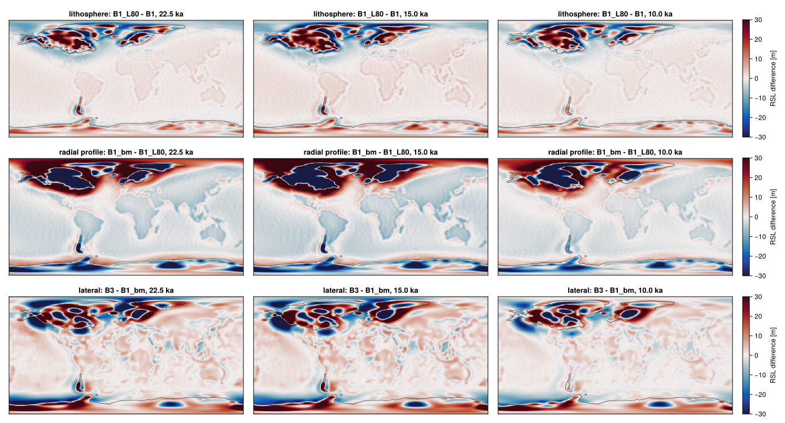
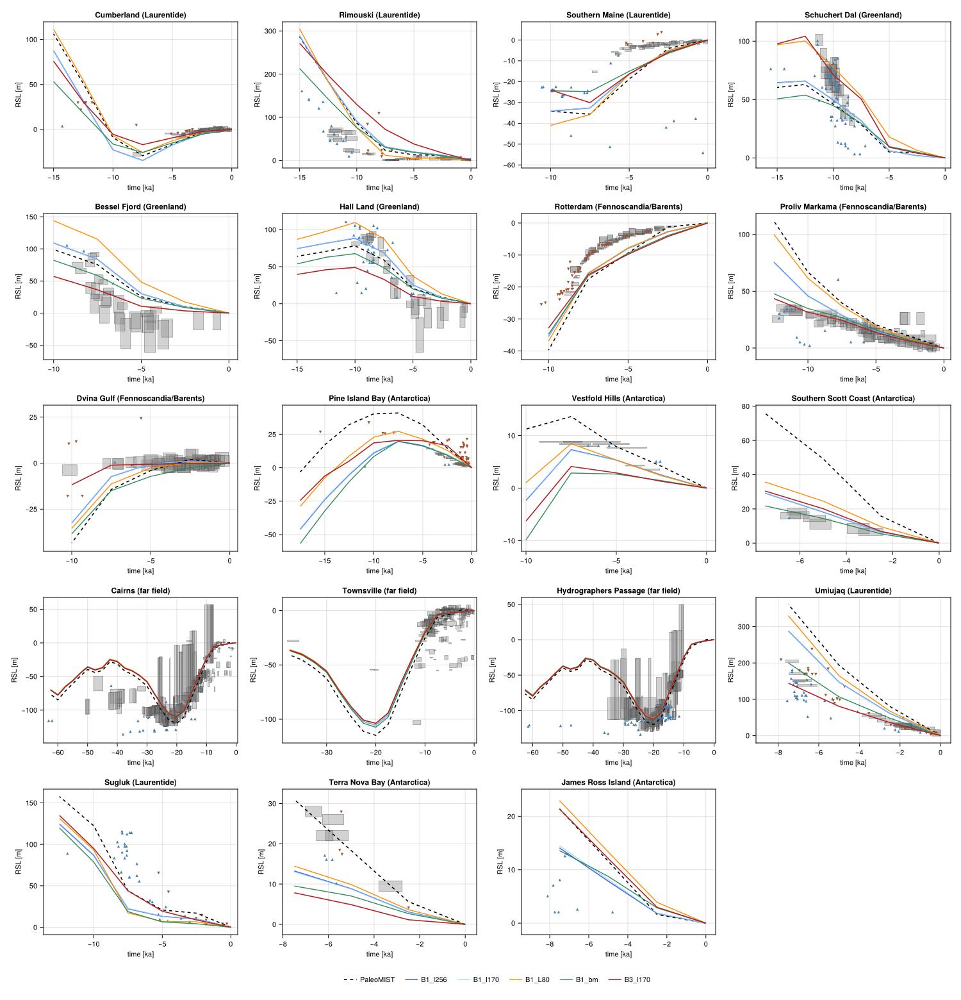
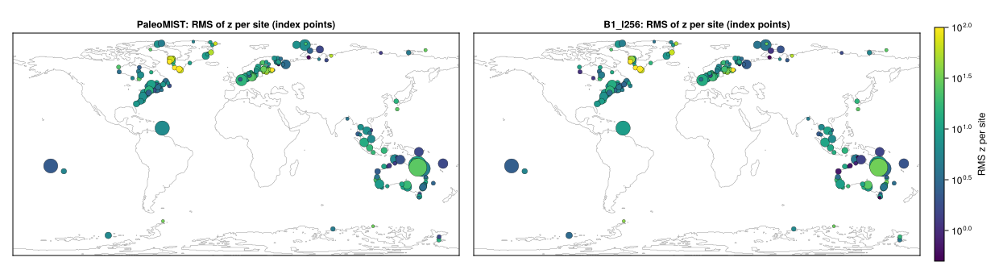

# VILMA2 standalone under the PaleoMIST ice history (Gowan et al. 2021)

Branch `vilma-paleomist`. Question: does the standalone VILMA2 (`vilma.x`, vilma2 523b660), driven by the PaleoMIST 1.0 ice history (minimal MIS 3 scenario) on Gowan's 1-D Earth, reproduce the sea level and bed of PaleoMIST; what do resolution and the 3-D Earth change; and how far is the LGM from equilibrium with the solid Earth.

- Scripts `tools/levante/pm_prep.jl` (inputs), `pm_run.sh` (sbatch, one run), `pm_visc1d.sh` and `pm_visc1d.f90` (the 1-D profile of the science Earth), `pm_compare.jl` (metrics, fields, indicator scores), `pm_maps.jl` (figures). Runs, inputs and comparison under `$G/runs/paleomist/` (`G=/work/ba1442/robinson/kryos-gate`).
- vilma.x of the S11 stack (`$G/stacks/S11/vilma2`, c17d513, tree identical to 523b660). Runs on the shared partition, 64 OpenMP threads.

## Setup

| | Gowan et al. (2021), SELEN | here, VILMA2 |
|---|---|---|
| sea-level equation | shoreline migration, grounding-line adjustment, rotation | same (`rotation = .true.`, flotation, sloping coast) |
| resolution | degree 256, 1 degree output | lmax 256 (and 170), Gauss grid 1024 x 514; compared on the 0.5 degree PaleoMIST grid |
| Earth | 1-D: 120 km elastic lithosphere, UM 4e20, LM 4e22 Pa s | `earth = "PREM"`, 12 layers: elastic 0-80-120 km, Maxwell 4e20 to 670 km (splits 220, 400, 600), 4e22 to the CMB (splits 771, 1428, 2084, 2741 km), fluid core; rho, mu the r^2 shell means of incompressible PREM |
| load history | 2.5 kyr steps, 80-0 ka | the 33 records as steps (`pm_force_B.nc`): record t_k enters over [t_k, t_k + 1 yr] and is held to t_{k+1} |
| before 80 ka | not stated | equilibrium with the 80 ka load: spin-up to `equil_rate_tol` 1e-5 m/yr |
| densities | not stated | VILMA2 defaults rho_ice 931, rho_water 1000 kg/m3 |
| reference | | present day = PaleoMIST 0 ka `z_bed` and `H_ice`, relaxed (`i_eq = 1`) |

- Ice: FesmData `GLOBAL-0.25DEG_IceHistory-PaleoMIST.nc` (the 0.25 degree product on the cell-centred FesmData grid), remapped conservatively to the Gauss grid by vilma.x (`remap_input`).
- Step convention: vilma.x ramps the ice linearly between two forcing slices, so an exact step needs a zero-length interval. A dt = 0 update applies the new load, but its diagnostics are those of the previous ice (KNOWN ISSUE in `vilma_timestep`), so the step is a 1-yr ramp instead; 1 yr is far below the shortest Maxwell time (100 yr in the 1-D Earth, 15 yr at the Bagge floor). Record t_k is compared with the state at t_k + 1 yr.
- Definitions (checked on the product): PaleoMIST `dz_sl` is the sea-level change from present, positive where the sea is higher than today against the land, `z_bed` is relative to the sea level of the time and z_bed(t) - z_bed(0) = -dz_sl(t) to 0.01 m. VILMA2's rsl has the same sign and z_bed = z_bed_eq - rsl, so Gowan's bed change relative to present is -RSL in both and has the RSL metrics with the bias negated. VILMA2's rsl is relative to the relaxed reference and is not zero at 0 ka (the Earth is still rebounding), while `dz_sl` is S(t) - S(0) by construction: the B runs are compared as rsl(t) - rsl(0 ka), as Gowan's. A - B compares both states against the same relaxed reference.
- Runs (`$G/runs/paleomist/`):

| run | load | Earth | lmax | spin-up cap |
|---|---|---|---|---|
| A1_l256, A1_l170 | 22.5 ka ice held, spin-up | 1-D Gowan | 256, 170 | 2e6 yr |
| B1_l256, B1_l170 | equilibrium with 80 ka, then 80 -> 0 ka | 1-D Gowan | 256, 170 | 2e6 yr |
| A3_l170 | as A1 | 3-D: science setting (PREM, 80 km lithosphere, Bagge 2021 structure 6, `pre_spinup_1d`) | 170 | 2e5 yr (3-D phase) |
| B3_l170 | as B1 | as A3 | 170 | 2e5 yr (3-D phase) |
| B1_L80 | as B1 | Gowan's viscosities on the science layers (80 km elastic lithosphere, 11 layers) | 170 | 2e6 yr |
| B1_bm | as B1 | the science Earth collapsed to 1-D: the profile of its `pre_spinup_1d`, laterally uniform | 170 | 2e6 yr |

Smoke: S_1d, S_3d (lmax 64, 25 -> 20 ka, spin-up cap 2 kyr).

## Convergence and cost

Spin-up (`solid_earth_spinup`): passes of 200 yr growing by 1.6, converged when the mean bed speed over a pass is below 1e-5 m/yr. All converged, none hit the cap.

| run | phase | passes | relaxed time | final mean speed [m/yr] | last pass: length, max bed change | wall time | memory |
|---|---|---|---|---|---|---|---|
| A1_l256, A1_l170 | 1-D | 15 | 384 kyr | 6.8e-6 | 144 kyr, 9.8 m | 10 min, 5 min | 4.3, 2.3 GB |
| B1_l256, B1_l170 | 1-D | 12 | 93 kyr | 6.6e-6 | 35 kyr, 3.6 m | 6 min, 3 min | 4.3, 2.7 GB |
| A3_l170 | 1-D pre-spin / 3-D | 15 / 12 | 384 / 93 kyr | 6.7e-6 / 7.8e-6 | 144 kyr, 19 m / 35 kyr, 2.8 m | 2 h 03 | 9.4 GB |
| B3_l170 | 1-D pre-spin / 3-D | 12 / 7 | 93 / 8.6 kyr | 7.4e-6 / 9.3e-6 | 35 kyr, 19 m / 3.4 kyr, 3.2 m | 1 h 44 | 9.5 GB |
| B1_L80 | 1-D | 12 | 93 kyr | 6.2e-6 | 35 kyr, 3.6 m | 3 min | 2.3 GB |
| B1_bm | 1-D | 12 | 93 kyr | 7.4e-6 | 35 kyr, 19 m | 6 min | 3.4 GB |

Wall times include the spin-up and, for B, the 80 kyr transient (1-D: sub-steps of 100 yr; 3-D: 11.6 yr, 1.5 h for the 80 kyr). The LGM equilibrium needs 384 kyr of relaxation in 1-D (Gowan's lower mantle 4e22, and the lateral mean of Bagge): a 2e4 yr cap on a full-model spin-up is far from it. After the 1-D pre-spin the 3-D phase needs 93 kyr (A3) or 8.6 kyr (B3). The criterion is a mean over a pass: the last 1-D pass of A still moves the bed by up to 10 m.

## Metrics

RSL relative to present [m] on the 0.5 degree grid, area weighted: RMS, max |d| and bias = mean(d), d = first - second. Regions: glaciated = ice at some record and ice-free today (Laurentide, Fennoscandia, Barents-Kara, Patagonia, the West Antarctic embayments); ocean = present ocean outside it; global. Gowan's bed change relative to present is -RSL: same RMS and max, bias negated. Full tables: `figures/vilma2-paleomist/pm_metrics.md`, all 33 records of B1 - PaleoMIST: `pm_metrics_B1_PM.csv`.

| comparison | ka | glac RMS | glac max | glac bias | ocean RMS | ocean max | ocean bias | global RMS | global max | global bias |
|---|---|---|---|---|---|---|---|---|---|---|
| B1 l256 - PaleoMIST | 22.5 | 23.7 | 91 | -0.9 | 8.7 | 33 | 8.5 | 10.2 | 91 | 7.5 |
| | 15 | 29.0 | 106 | -6.7 | 7.5 | 22 | 7.3 | 10.2 | 106 | 6.0 |
| | 10 | 28.8 | 110 | -8.2 | 5.2 | 14 | 5.1 | 8.8 | 110 | 4.0 |
| B1 l170 - B1 l256 | 22.5 | 0.4 | 1.7 | 0.0 | 0.1 | 1.4 | 0.0 | 0.1 | 1.9 | 0.0 |
| | 15 | 0.4 | 2.0 | 0.0 | 0.1 | 1.7 | 0.0 | 0.2 | 2.0 | 0.0 |
| | 10 | 0.3 | 2.1 | 0.0 | 0.1 | 1.2 | 0.0 | 0.1 | 2.2 | 0.0 |
| B3 - B1 (l170) | 22.5 | 52.6 | 196 | -7.2 | 6.9 | 112 | -0.2 | 14.6 | 196 | -0.3 |
| | 15 | 57.1 | 230 | -13.0 | 7.5 | 118 | -0.2 | 16.1 | 230 | -0.4 |
| | 10 | 45.8 | 180 | -8.8 | 5.3 | 107 | -0.1 | 12.4 | 180 | -0.4 |
| B3 - PaleoMIST | 22.5 | 60.1 | 228 | -8.1 | 10.8 | 107 | 8.3 | 18.1 | 228 | 7.2 |
| A1 - B1 (l256), RSL | 22.5 | 146.9 | 470 | 112.9 | 11.8 | 168 | -0.2 | 37.8 | 470 | 9.0 |
| A1 - B1 (l256), u | 22.5 | 154.9 | 497 | -117.5 | 26.5 | 176 | 11.9 | 45.0 | 497 | 0.0 |
| A3 - B3 (l170), RSL | 22.5 | 166.4 | 476 | 119.9 | 12.2 | 125 | 0.0 | 42.4 | 476 | 9.6 |
| A3 - B3 (l170), u | 22.5 | 178.1 | 501 | -127.4 | 25.6 | 136 | 12.4 | 49.3 | 501 | 0.0 |
| B1 l256 at 0 ka vs relaxed reference, RSL | 0 | 96.2 | 294 | 59.6 | 8.8 | 74 | -2.3 | 25.2 | 294 | 3.2 |
| B3 at 0 ka vs relaxed reference, RSL | 0 | 102.1 | 429 | 59.0 | 8.3 | 56 | -2.2 | 26.4 | 429 | 3.3 |

A - B is against the relaxed reference (u = the radial bed displacement, dz_bed). At 22.5 ka the barystatic sea level (ocean mean of RSL relative to present) is -110.3 m in B1 and B3 against -116.3 m for the ocean mean of PaleoMIST's `dz_sl` (and -101.7 m for Gowan's ice-volume ESL at 910 kg/m3, 361e6 km2); at Barbados B1 gives -95.9 m against -105.0 m.

## Figures

RSL relative to present of PaleoMIST and B1 (lmax 256) and their difference; black: the 22.5 ka ice margin.

Top: lmax 170 - 256 (B1), +-5 m. Bottom: 3-D - 1-D (B3 - B1 at lmax 170), +-30 m.

RSL relative to present at the sites: every output step of the B runs (the step at each record, then the relaxation over the 2.5 kyr) and the PaleoMIST records. B1 l170 lies on B1 l256. B1_L80 and B1_bm: see the decomposition below.

VILMA2 barystatic sea level (bsl - bsl(0)) and ice-volume equivalent (bsl_ive) against PaleoMIST's ocean mean of `dz_sl` and its ESL series.

Equilibrium under the 22.5 ka ice (A) minus the transient (B) at 22.5 ka, RSL and bed displacement u, +-300 m.

RSL of B at 0 ka against the relaxed present-day reference.

## Findings

1. **VILMA2 reproduces PaleoMIST to about 10 m globally and 25-30 m RMS over the formerly glaciated areas** (B1, 22.5-10 ka). Fennoscandia matches within about 15 m through both glacial cycles (Gulf of Bothnia). The misfit is largest where the ice sat on deep marine beds: in the Ross and Weddell embayments VILMA2's RSL rise is about half of PaleoMIST's (up to 100 m less at 10 ka), over Hudson Bay 60 m less at 20-15 ka, and the Barents peaks are lower. VILMA2 grounds 99 % of the Antarctic LGM ice volume, so its flotation is not the cause. A marine-ice load in SELEN without the displaced water would have this pattern (the net load is the ice minus the water column it replaces); this cannot be checked without Gowan's load files. The other differences from SELEN (elastic structure, normal modes against VILMA2's explicit memory stepping) would not single out the marine beds.
2. **The far field is 5-8 m less deep in VILMA2 at the LGM** (ocean bias +8.5 m at 22.5 ka, Barbados -96 against -105 m; barystatic -110 against -116 m), while the ice-volume equivalent is -121 m. Part of it is the definition of the ocean mean (VILMA2's ocean function against PaleoMIST's z_bed < 0 and ice-free), the rest is not resolved.
3. **lmax 170 is enough.** lmax 170 differs from 256 by 0.4 m RMS and at most 2.4 m, for half the cost.
4. **The 3-D science Earth changes the deglacial RSL by 50 m RMS over the glaciated areas, up to 230 m**: much smaller over Fennoscandia and the Barents Sea (stiff cratonic mantle; Gulf of Bothnia peaks of 60-100 m against 300 m), larger over the Laurentide margins and West Antarctica. The global and ocean means are unchanged (bias -0.2 m). It moves the fit to PaleoMIST from 24 to 60 m RMS, as expected: PaleoMIST is built on the 1-D Earth. B3 - B1 is the science setting against Gowan's Earth, so it includes the 80 against 120 km lithosphere and the radial profile, not the lateral structure alone (split in finding 7).
5. **The LGM is far from equilibrium with the solid Earth.** At 22.5 ka the equilibrium bed under the same ice is on average 120 m lower over the glaciated areas than the transient one, up to 500 m west of Hudson Bay (RSL 113 m higher, up to 470 m), with both Earths (1-D 147 m RMS, 3-D 166 m). The far field differs by about 12 m RMS. An LGM start from an equilibrium spin-up therefore overstates the LGM bed depression by hundreds of metres under the large ice sheets.
6. **The present day is not relaxed after this history** (up to 294 m of RSL left over Hudson Bay in 1-D, 429 m in 3-D). With `i_eq = 1` the present-day state of a deglaciation run is not the reference; comparisons with PaleoMIST must be relative to the 0 ka state, as Gowan's.

## The 3-D effect split, and the sea-level indicators

Branch `pm-indicators`.

### Two more 1-D Earths

- **B1_L80**: Gowan's viscosities (4e20 to 670 km, 4e22 below) on the 11 layers of the science setting, 80 km elastic lithosphere. The 80-220 km layer is one shell (rho, mu its shell means) instead of B1's 80-120 and 120-220 km, so B1_L80 - B1 is the lithosphere with that merge.
- **B1_bm**: the science Earth (11 layers, Bagge 2021 structure 6) collapsed to the 1-D profile that `pre_spinup_1d` uses: per FE node (221 nodes), the unweighted mean over the Gauss grid of log10 eta after VILMA2's read, interpolation and clamp (`load_visc_3d`). `pm_visc1d.f90` calls these routines of libvilma (S11) with the namelist of B3 and writes the profile; `pm_prep.jl visc1d` writes it as a laterally uniform viscosity file in the FesmData form on the node depths (`$P/data/pm_visc_bm.nc`), which vilma.x reads back unchanged (`EARTH=bm`, `visc3d split: 0 of 220`). The profile varies within the layers: 1e20.5-1e23.7 Pa s at 80-220 km (the cratonic roots), 1e20.2-1e20.7 at 220-400 km (Bagge floor 1e19.5), 1e21.0-1e21.5 at 400-670 km, up to 1e23.1 in the lower mantle. Check: the spin-up of B1_bm repeats the 1-D pre-spin of B3 pass by pass (same bed change and speed to the printed digits).
- Then B3 - B1 = (B1_L80 - B1) + (B1_bm - B1_L80) + (B3 - B1_bm): lithosphere, radial profile, lateral structure.

| RSL difference [m] | ka | glac RMS | glac max | glac bias | ocean RMS | ocean max | ocean bias | global RMS | global max | global bias |
|---|---|---|---|---|---|---|---|---|---|---|
| lithosphere, B1_L80 - B1 | 22.5 | 20.5 | 71 | 8.2 | 2.6 | 46 | 0.0 | 5.8 | 71 | 0.9 |
| | 15 | 23.0 | 70 | 11.8 | 3.4 | 52 | 0.0 | 6.7 | 70 | 1.2 |
| | 10 | 19.4 | 81 | 7.3 | 2.6 | 55 | 0.0 | 5.5 | 81 | 0.8 |
| radial profile, B1_bm - B1_L80 | 22.5 | 54.7 | 154 | -23.4 | 7.4 | 105 | 0.0 | 15.3 | 154 | -2.2 |
| | 15 | 61.0 | 157 | -32.9 | 8.7 | 109 | 0.2 | 17.2 | 157 | -2.7 |
| | 10 | 45.7 | 165 | -19.1 | 5.5 | 91 | 0.2 | 12.4 | 165 | -1.6 |
| lateral, B3 - B1_bm | 22.5 | 31.6 | 149 | 8.0 | 6.9 | 79 | -0.3 | 10.3 | 150 | 1.0 |
| | 15 | 38.7 | 214 | 8.2 | 7.5 | 91 | -0.4 | 12.1 | 214 | 1.1 |
| | 10 | 25.5 | 106 | 3.1 | 4.2 | 76 | -0.3 | 7.7 | 106 | 0.4 |
| total, B3 - B1 (l170) | 22.5 | 52.6 | 196 | -7.2 | 6.9 | 112 | -0.2 | 14.6 | 196 | -0.3 |
| | 15 | 57.1 | 230 | -13.0 | 7.5 | 118 | -0.2 | 16.1 | 230 | -0.4 |
| | 10 | 45.8 | 180 | -8.8 | 5.3 | 107 | -0.1 | 12.4 | 180 | -0.4 |

The 3-D effect split, lmax 170, +-30 m: lithosphere, radial profile, lateral structure.

### Indicators

GAPSLIP 2.1 (Gowan 2023, Zenodo 10.5281/zenodo.10121689, commit 1c72e2f), FesmData `Records/RSL/RSL-GAPSLIP_global.nc` (FesmData 47cbb83): the primary data (no alternative interpretations or uplift corrections) of 0-80 ka, 8825 samples, 4752 index points. RSL relative to present as above (PaleoMIST `dz_sl`; VILMA2 rsl(t) - rsl(0 ka)), bilinear at the sample, linear in time between the records. Index points: z = (model - obs)/sigma, sigma^2 = sigma_z^2 + (dRSL/dt sigma_t)^2, sigma_z half the 2-sigma elevation range on the side of the misfit, sigma_t half the 2-sigma age range, dRSL/dt the model slope. Limiting data are violated when no model RSL over the 2-sigma age range reaches the 2-sigma elevation range (marine: max < rsl_min; terrestrial: min > rsl_max). Groups of Gowan's regions: Laurentide (North America Arctic and Atlantic), Greenland, Fennoscandia/Barents (Europe, Eurasian Arctic), Antarctica, far field (the rest). All tables, also lmax 170 and the mean misfit: `figures/vilma2-paleomist/pm_indicators.md`.

Index points, RMS z / median |z| / fraction |z| <= 2:

| set | n | PaleoMIST | B1 | B1_L80 | B1_bm | B3 |
|---|---|---|---|---|---|---|
| all | 4752 | 29.5 / 4.4 / 0.30 | 30.9 / 4.4 / 0.31 | 26.4 / 4.3 / 0.31 | 23.8 / 4.4 / 0.30 | 26.7 / 4.6 / 0.31 |
| Laurentide | 896 | 9.0 / 4.1 / 0.26 | 9.6 / 5.3 / 0.19 | 8.6 / 4.3 / 0.29 | 9.7 / 5.3 / 0.20 | 10.4 / 5.7 / 0.25 |
| Greenland | 276 | 107 / 11.1 / 0.04 | 113 / 9.3 / 0.09 | 92 / 10.0 / 0.12 | 79 / 8.8 / 0.10 | 71 / 10.2 / 0.12 |
| Fennoscandia/Barents | 1088 | 19.9 / 7.8 / 0.17 | 16.5 / 5.8 / 0.28 | 15.2 / 6.5 / 0.22 | 14.1 / 5.5 / 0.27 | 33.1 / 8.3 / 0.27 |
| Antarctica | 47 | 9.8 / 5.5 / 0.15 | 9.8 / 3.5 / 0.21 | 8.5 / 4.9 / 0.15 | 33.9 / 3.1 / 0.32 | 17.3 / 7.5 / 0.04 |
| far field | 2445 | 13.6 / 2.9 / 0.41 | 16.0 / 3.2 / 0.38 | 16.4 / 3.2 / 0.38 | 16.0 / 3.4 / 0.38 | 16.9 / 3.2 / 0.38 |
| Hudson Bay (0.2-8.7 ka) | 61 | 12.3 / 4.4 / 0.18 | 8.2 / 3.3 / 0.33 | 9.0 / 3.7 / 0.30 | 5.4 / 1.8 / 0.54 | 4.3 / 1.3 / 0.61 |
| Ross Sea (2.5-6.7 ka) | 12 | 11.1 / 4.9 / 0.25 | 11.3 / 4.9 / 0.17 | 11.6 / 8.9 / 0.00 | 14.2 / 2.4 / 0.42 | 16.1 / 7.2 / 0.08 |

Limiting data, fraction violated, marine / terrestrial:

| set | n | PaleoMIST | B1 | B1_L80 | B1_bm | B3 |
|---|---|---|---|---|---|---|
| all | 2605 / 1468 | 0.45 / 0.30 | 0.42 / 0.30 | 0.37 / 0.30 | 0.46 / 0.19 | 0.41 / 0.24 |
| Laurentide | 566 / 484 | 0.20 / 0.28 | 0.25 / 0.25 | 0.25 / 0.25 | 0.25 / 0.18 | 0.25 / 0.23 |
| Greenland | 647 / 96 | 0.69 / 0.01 | 0.59 / 0.03 | 0.28 / 0.08 | 0.60 / 0.02 | 0.54 / 0.03 |
| Fennoscandia/Barents | 521 / 632 | 0.32 / 0.41 | 0.26 / 0.44 | 0.45 / 0.41 | 0.42 / 0.24 | 0.29 / 0.31 |
| Antarctica | 169 / 115 | 0.68 / 0.26 | 0.71 / 0.17 | 0.62 / 0.20 | 0.76 / 0.10 | 0.76 / 0.15 |
| far field | 702 / 141 | 0.46 / 0.16 | 0.44 / 0.18 | 0.42 / 0.24 | 0.45 / 0.18 | 0.41 / 0.16 |
| Hudson Bay | 114 / 68 | 0.03 / 0.71 | 0.14 / 0.56 | 0.13 / 0.62 | 0.22 / 0.21 | 0.32 / 0.03 |
| Ross Sea | 5 / 4 | 0.00 / 0.00 | 0.60 / 0.00 | 0.60 / 0.00 | 0.80 / 0.00 | 0.80 / 0.00 |
| James Ross Island | 9 / 0 | 0.00 / - | 0.00 / - | 0.00 / - | 0.00 / - | 0.00 / - |

B1 = B1_l256 (B1_l170: the same median |z| and fractions to 0.1 and 0.02); Hudson Bay = Gowan's sector Hudson_Bay; Ross Sea = Southern Scott Coast and Terra Nova Bay.

RSL relative to present at the three sites with most index points per group and at the marine-bed sites: index points (2-sigma boxes), marine limiting (up triangles: sea level above), terrestrial limiting (down triangles: below), and the models at the records.

Per site, RMS of z over its index points (marker size: their number), PaleoMIST and B1.

### Findings

7. **The 3-D effect is mostly the radial profile.** Over the glaciated areas at 22.5-10 ka, the lateral mean of Bagge's structure against Gowan's 4e20/4e22 changes RSL by 46-61 m RMS (bias -19 to -33 m: the softer upper mantle relaxes faster), the lateral structure by 26-39 m RMS (up to 214 m; bias +3 to +8 m), the 80 against 120 km lithosphere by 19-23 m RMS (up to 81 m; bias +7 to +12 m). The three partly cancel, so B3 - B1 (46-57 m RMS) is no larger than the radial part alone.
8. **Against the indicators, VILMA2 under PaleoMIST on Gowan's Earth (B1) scores as PaleoMIST itself** (median |z| 4.4 for both, 30-31 % of 4752 index points within 2 sigma, 42-45 % of marine and 30 % of terrestrial limiting data violated). The RMS of z (24-31) is set by the 10 % of index points with |z| > 20, many with sigma_z of 0.1-0.3 m; the largest are at Greenland coastal sites (Paamiut, Sisimiut), where PaleoMIST is 50-130 m off. B1 is better over Fennoscandia/Barents (median |z| 5.8 against 7.8) and Antarctica, PaleoMIST over the Laurentide (4.1 against 5.3) and the far field (2.9 against 3.2; B1 is 4 m higher than PaleoMIST there on average, finding 2).
9. **Hudson Bay: the data favour VILMA2's lower RSL, and the science Earth most.** The 61 index points (0.2-8.7 ka, after the deglaciation) lie on average 42 m below PaleoMIST (71 % of the terrestrial limiting data violated), 20 m below B1; B1_bm is within 1 m of them on average and B3 8 m below (median |z| 1.3-1.8, 54-61 % within 2 sigma). There are no data during the 20-15 ka difference itself (under the ice), only its Holocene residual.
10. **Ross and Weddell: too few data to decide.** The Ross Sea has 12 index points of 2.5-6.7 ka on its western coast: PaleoMIST is 21 m too high on average (too high at the Scott Coast, close at Terra Nova Bay), B1 2 m too low, with the same RMS z (11) and 3 of 5 marine limiting data violated by B1, none by PaleoMIST. GAPSLIP has no data in the Weddell embayment; the 9 marine limiting data of James Ross Island (4.8-8.1 ka) are met by all models.
11. **The science Earth does not improve the fit overall** (B3 median |z| 4.6; B1_bm has the lowest RMS z, 23.8, and the fewest terrestrial violations, 19 %, but more marine ones): it improves Hudson Bay and worsens Fennoscandia/Barents (RMS z 33 against 17, median |z| 8.3 against 5.8) and Antarctica. PaleoMIST was built on Gowan's Earth, so the ice history and the Earth are not independent here.

### Not as planned

- GAPSLIP 2.1 (2023) rather than the version of 2021 used in Gowan et al. (2021) (1.0): Antarctic data came only with 1.3, 2.0 recalibrated all ages (IntCal20, Marine20), and Gowan's PaleoMIST reports use 2.0. It was already in the FesmData manifest (no new download).
- B1_bm uses the node profile of `pre_spinup_1d`, which varies within the layers, not one viscosity per layer; the mean over the Gauss grid is unweighted, as in VILMA2.
- Greenland is a group of its own; median |z| is added to the requested RMS of z.

## Not as in Gowan et al. (2021)

- Steps as 1-yr ramps (see Setup); records compared 1 yr after their step.
- Earth: VILMA2's incompressible PREM shell means in 12 layers; the 670 km boundary, PREM and incompressibility assumed. VILMA2's explicit memory scheme (`fe`, cfl 1, sub-steps of 100 yr) against SELEN's normal modes.
- Equilibrium with the 80 ka load before the history (assumed); densities 931/1000 (assumed); VILMA2's degree-1 frame (centre of mass) and its flotation and sloping-coast ocean load.
- Inputs from FesmData: the 0.25 degree product remapped to the cell-centred FesmData grid (forcing), the 0.5 degree product (comparison), not Gowan's gridline-registered 0.25 degree file.
- The 3-D runs use the science setting (80 km lithosphere, Bagge 2021 on the CLIMBER-X radial profile), not Gowan's layers.
