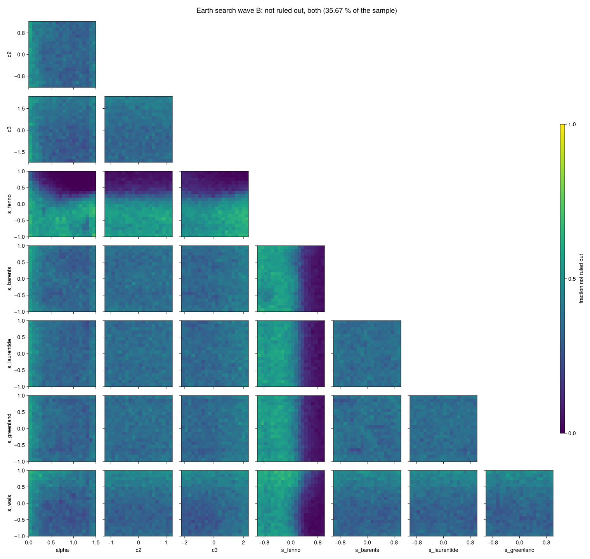

Which Earth do the sea-level data want, independently of our ice? Imposed ice on many sampled Earths, scored as every
other simulation ([Data and scores](data-scores.md)), with an emulator to cover the space that was not run. Status
2026-11-16: wave A done, wave B emulated on 96 of its 100 runs, wave B2 running.

## Why

The expert 3-D viscosity fields (Bagge et al. 2021, Lloyd et al. 2024, Pan et al. 2022) disagree by about 1 dex in the
lower mantle and the lithosphere, and none was ranked against RSL data. Regional inversions constrain Fennoscandia and
Hudson Bay and leave the rest open. And the one 3-D structure we had used (Bagge's structure 6) fails Fennoscandia under
both published ice histories, while its radial mean passes ([Results](results.md#imposed-ice-on-our-solver)). Searching
around one expert field is therefore too narrow.

Two principles follow:

- **Search broadly, report the distance from the experts separately.** Closeness to an expert field is not built into
  the score. Each Earth gets its distance from the experts as a second axis next to its fit: an Earth far from the
  experts that fits much better is a finding, one that fits a little better is not.
- **Two ice histories.** Every Earth runs under PaleoMIST's ice and under GLAC-1D's. An Earth search with one fixed ice
  history blames that ice's errors on the Earth; an Earth pattern counts when it holds under both.

## The parameters

A field of 13 parameters: a radial profile, the experts' lateral pattern scaled, and regional upper-mantle shifts,

log10 η(x, z) = P(z) + α A(x, z) + c₂ φ₂(x, z) + c₃ φ₃(x, z) + Σ_j s_j w_j(x) [z < 670 km],

clamped to [19.5, 30] and elastic above the lithosphere.

| part | parameter | prior range | note |
|---|---|---|---|
| radial profile P | lithosphere (elastic) thickness | 50-200 km | Gowan 120 km |
| | upper mantle (UM, lithosphere to 410 km) | 10^19.5-10^21.5 Pa s | Gowan 4×10²⁰ |
| | transition zone (TZ, 410-670 km) | 10^20-10^22.5 | |
| | lower mantle 1 (LM1, 670-1500 km) | 10^21-10^23.5 | Gowan 4×10²² |
| | lower mantle 2 (LM2, 1500-2891 km) | 10^21-10^23.5 | |
| lateral | α, the amplitude of the experts' mean lateral anomaly A | 0-1.5 | α = 0: a 1-D Earth; the experts have α = 1 |
| | c₂, c₃, two components of the expert basis (Lloyd against Pan; Bagge's reduction factor) | the experts' range | |
| regional | s_j, upper-mantle shifts in Fennoscandia, Barents, Laurentide, Greenland, West Antarctica | ±1 dex | |

The expert basis is a principal-component decomposition of ten expert fields (Bagge's structures 1-8, Lloyd's, Pan's),
each clamped to [19.5, 24]. Its mean minus its radial mean gives A; φ₂ and φ₃ are the lateral parts of its second and
third components (the first is mostly radial and so belongs to P). No published GIA study uses such a basis: the
established approaches are 1-D inversions, factorial ensembles of 3-D structures, or one scaling of a tomographic
model.

## Waves, emulator and cut

The search runs in waves, each focused by the emulator of the last:

1. **Wave A, 1-D Earths.** 200 radial profiles (a Latin hypercube over the 5 radial parameters) × 2 ice histories,
   each run iterated to its own r.
2. **Wave B, 3-D Earths.** 50 Earths, their radial part from the space wave A did not rule out under either ice
   history, the 8 lateral parameters in a Latin hypercube. Per Earth and ice two runs: the radial profile alone (1-D,
   iterated to its r) and the 3-D Earth in one pass with that r. The pair isolates the effect of the lateral structure
   on the same profile. Iterating a 3-D Earth to its own r changes its log L by a few units only (tested on E002).
3. **Wave B2, a widened box.** 30 Earths where wave B pressed against the prior ([below](#wave-b2)).
4. **Wave C, our ice.** The final τ_b ensemble on a handful of plausible Earths
   ([The ice: τ_b ensembles](ice-ensembles.md#the-final-ensemble-proposed)).

**Emulator.** Per data group and ice history, a Gaussian process (Matérn 5/2, hyperparameters by maximum likelihood)
predicts y = log(χ²/n) and its uncertainty anywhere in the parameter space. For wave B, 100 runs are too few for a GP in
13 dimensions, so the 3-D score is the 1-D score of the profile (the wave-A GP) plus a GP of the lateral effect
Δ = y_3D − y_1D in the 8 lateral parameters, their variances added.

**Cut.** A point is ruled out when the emulator is confident (3 sd) that it fails the bar in a group that judges:
(E[y] − y_cut)/sd > 3, with y_cut the bar of [Data and scores](data-scores.md#the-bar) on the scale of y. The
emulator's own uncertainty therefore keeps points it cannot judge.

## Wave A: 1-D Earths

400 runs (2026-11-13). The emulator reproduces the runs well (leave-one-out R² 0.96-0.998 for the RSL groups, 0.78-0.89
for the far field, 0.85-0.98 for GNSS).

| ice history | not ruled out | lithosphere [km] | UM | TZ | LM1 | LM2 |
|---|---|---|---|---|---|---|
| PaleoMIST | 20.2 % | 54-167 | 19.7-21.2 | 20.1-22.4 | 21.1-23.4 | 21.1-23.3 |
| GLAC-1D | 13.5 % | 54-145 | 20.4-21.4 | 20.1-22.2 | 21.1-23.4 | 21.1-23.4 |
| both | 4.9 % | 54-140 | 20.3-21.4 | 20.0-22.3 | 21.1-23.4 | 21.1-23.4 |
| either | 28.8 % | 54-162 | 19.8-21.3 | 20.1-22.4 | 21.1-23.4 | 21.1-23.4 |

(5-95 % ranges of the points not ruled out; log10 η in Pa s.)

- **The upper mantle orders the scores, the lower mantle hardly matters.** The lithosphere (thinner than about 170 km)
  and the upper mantle are constrained; the transition zone and the lower mantle are not, in 1-D.
- **Fennoscandia rules out half of the space** (it wants a thin lithosphere and a soft UM and TZ), Greenland a quarter
  (a stiffer UM), the GNSS rates 23-62 %. The far field, Antarctica and ESL rule out nothing.
- **The two ice histories want different Earths.** PaleoMIST's ice a soft UM (10^20.1-20.4) with a stiffer TZ,
  GLAC-1D's a UM of 10^20.6-21. Requiring both would rule Earths out for the ice's sake, so wave B samples from
  "either".
- **Gowan's Earth is not among the best under either ice.** The best 1-D Earths gain 60 (PaleoMIST) and 127 (GLAC-1D)
  in log L, mostly in Greenland and, under GLAC-1D, the far field. No 1-D Earth fits the GNSS rates of Fennoscandia and
  Hudson Bay under PaleoMIST's ice.

## Wave B: 3-D Earths

96 of 100 3-D runs and all 100 1-D runs (2026-11-16; the last 4 runs are queued).

**What the emulator can say.** From 48 runs per ice history in 8 lateral dimensions, the lateral effect Δ is emulated
weakly (leave-one-out R² 0.7 in Fennoscandia, 0.2-0.6 in most groups, about 0 for GNSS under PaleoMIST), but honestly:
92-100 % of the runs lie within 2 sd and none that passes is ruled out. Its variance adds to wave A's, so wave B keeps
more of its 13-D space (PaleoMIST 42 %, GLAC-1D 45 %, both 36 %) than wave A of its 5-D space; the fractions are not
comparable as constraints.

- **The upper mantle and the transition zone trade off.** The space left runs along a ridge from a soft UM over a stiff
  TZ (10^19.7 over 10^22.4) to a stiffer UM over a soft TZ (10^21 over 10^20.2); a stiff UM over a stiff TZ is ruled
  out. The data constrain a combined viscosity from the lithosphere to 670 km rather than the two layers.
- **Of the lateral parameters, only the Fennoscandian shift is constrained**: −0.94 to +0.44 dex (5-95 %); a stiffer
  upper mantle there is ruled out. The amplitude α, the expert components and the other shifts keep their ranges.
- **Lateral structure usually costs fit.** A 3-D Earth beats its own radial profile in 13 of 48 cases under GLAC-1D and
  15 of 48 under PaleoMIST. On average the lateral structure worsens Laurentide and Fennoscandia and leaves the other
  groups unchanged.
- **The space presses against the prior** where the TZ is low (10^20) or high (10^22.5, the two ends of the ridge),
  LM1 low (10^21), α low, the Fennoscandian shift low (−1) and the West Antarctic shift high (+1).

**The best 3-D Earths** (log L over the RSL groups, the 1-D run of the same profile in brackets; I per group: Laurentide /
Greenland / Fennoscandia / Barents / Antarctica / far field | GNSS Fennoscandia / Hudson Bay | ESL; references: Gowan's
Earth under PaleoMIST −8860, under GLAC-1D −8835):

| ice | Earth | log L (1-D) | passed | I |
|---|---|---|---|---|
| GLAC-1D | E014 | **−8717** (−9140) | 8/9 | −3.0 / 3.2 / 0.7 / 2.0 / −0.3 / −3.2 \| 7.8 / 1.2 \| 3.4 |
| GLAC-1D | E036 | −8893 (−8825) | 8/9 | 2.1 / 6.7 / 3.8 / 0.7 / −0.8 / −4.5 \| 0.5 / 2.1 \| 3.4 |
| GLAC-1D | E038 | −8842 (−8797) | 7/9 | −0.3 / 3.1 / 5.5 / 1.0 / 0.8 / −4.5 \| 7.4 / 2.8 \| 3.4 |
| GLAC-1D | E043 | −8952 (−8763) | 7/9 | 4.9 / 2.6 / 4.2 / 0.9 / 0.1 / −1.8 \| 2.4 / 1.8 \| 3.4 |
| PaleoMIST | E014 | **−8836** (−8884) | 8/9 | −2.5 / 2.6 / 1.4 / 0.8 / 2.6 / −1.3 \| 5.6 / 1.0 \| 6.0 |
| PaleoMIST | E043 | −8966 (−8935) | 8/9 | 2.9 / 1.4 / 4.9 / 1.3 / 0.6 / −1.7 \| 2.3 / 0.9 \| 6.0 |
| PaleoMIST | E041 | −8857 (−8819) | 7/9 | −3.5 / 3.3 / 2.0 / 2.2 / 0.4 / −1.1 \| 4.9 / 4.5 \| 5.9 |
| PaleoMIST | E015 | −8900 (−8967) | 7/9 | 0.2 / 5.4 / 1.9 / 1.8 / 1.6 / −1.7 \| 7.5 / 7.4 \| 5.9 |

| Earth | lithosphere, UM / TZ / LM1 / LM2 | α, c₂, c₃ | shifts F / B / L / G / W | distance from the experts (radial, lateral) |
|---|---|---|---|---|
| E014 | 55 km, 19.68 / 22.47 / 21.13 / 21.09 | 0.74, −1.18, −0.60 | −0.6 / +0.9 / −1.0 / +0.7 / +0.1 | 0.96 dex (Pan), 0.72 (Lloyd) |
| E036 | 124 km, 21.39 / 20.64 / 21.24 / 21.75 | 0.08, −0.95, −0.04 | −0.1 / +0.3 / +0.4 / +0.9 / +0.8 | 0.46 (Pan), 0.96 (Lloyd) |
| E043 | 157 km, 20.98 / 20.60 / 22.09 / 21.02 | 0.59, −0.17, +2.27 | 0.0 / −0.9 / +0.7 / −0.4 / −0.5 | 0.67 (Lloyd), 0.47 (Bagge 2) |
| E041 | 110 km, 20.51 / 21.09 / 23.36 / 21.11 | 0.34, +0.20, +2.00 | −0.2 / +0.5 / −0.7 / +0.7 / +0.2 | 1.13 (Lloyd), 0.71 (Bagge 2) |

**E014.** The one 3-D Earth that passes 8 of 9 groups under both ice histories and beats Gowan's Earth under both. Its
lateral structure gains 422 in log L over its own radial profile under GLAC-1D's ice and turns both GNSS groups from
failing (I 24 and 5) to nearly passing; under PaleoMIST's ice the gain is smaller (+49) but again mostly in the GNSS
rates. On the RSL log L alone, the best 1-D Earths of wave A fit as well under GLAC-1D's ice (−8709) and better under
PaleoMIST's (−8801); what sets E014 apart is that it fits the RSL and the present-day rates together.

Laterally E014 is close to Lloyd's field (c₂ −1.18 against Lloyd's −1.22; pattern correlation 0.86-0.97 at every depth)
with 74 % of the experts' amplitude; Bagge's structures correlate at 0.5-0.7 in the upper mantle and transition zone.
Radially it is unlike any expert: a soft upper mantle (10^19.8 as an area mean, the experts 10^20.2-20.9), a stiff
transition zone (10^22.4, the experts 10^20.4-21.3) and a soft lower mantle (10^21.1, the experts 10^21.3-22.8), with a
55 km lithosphere.

**Is the stiff transition zone needed?** Not on its own. Along the transition zone alone most groups barely change; a
stiff one helps Fennoscandia and Antarctica under PaleoMIST's ice. Against the upper mantle, E014 sits at one end of the
UM-TZ ridge: a stiffer upper mantle (10^20.5-21) over a transition zone in the experts' range fits as well. E014 also
sits at the edges of the prior (TZ 22.47 of 22.5; LM1 and LM2 near 21), which may be the spread of the sample rather
than the data.

## Wave B2

Wave B pressed against the prior at both ends of the UM-TZ ridge, so wave B2 (decided 2026-11-16) samples 30 3-D Earths
(E101-E130) in two widened boxes:

| box | Earths | lithosphere [km] | UM | TZ | LM1 | LM2 |
|---|---|---|---|---|---|---|
| S, the soft end around E014 | 16 | 50-90 | 19.0-20.3 | 21.5-23.5 | 20.5-21.8 | 20.5-22.5 |
| H, a stiff UM over a soft TZ | 14 | 50-200 | 20.8-21.5 | 19.5-20.5 | 20.5-22.0 | 20.5-23.5 |

Both boxes: α 0-1.5 (down to 1-D Earths, which wave B favours), c₂ and c₃ over the experts' range, the Fennoscandian
shift −1.5 to +0.5, the West Antarctic shift −0.5 to +1.5, the others ±1 dex. The field is clamped at 10^19.0 instead of
10^19.5. The emulator is then refitted over waves A, B and B2 together: the radial GPs on every 1-D run (the B2 profiles
lie outside wave A's box), the lateral GP on 78 3-D Earths per ice history.

The question it answers: does the best region lie outside the prior, and which 4-6 Earths carry into the final
ensemble?
