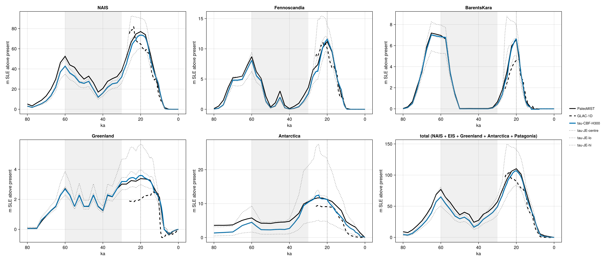

Our ice and the Earth sampled together: the Coulomb law of the coupled runs (C7, [Results](results.md)), the LGM timing
of the margin and the Earth in one design, scored on the 9 groups and history-matched with an emulator. Status
2026-11-18: code and smoke test done; wave 1 (200 members) set up, not yet submitted.

## Why

The Coulomb runs C1-C8 vary one thing at a time on one Earth (E117, wave A's best 1-D Earth under PaleoMIST's ice).
Their scores move by tens in log L with H_N, λ_min, c_f and the margin, as much as between the Earths of the Earth
search, and ESL fails on all of them. The Earth search, on the other hand, ruled Earths out under imposed ice, whose
errors it cannot separate from the Earth's. Sampling both together asks which combinations of our ice and the Earth the
data allow, and whether ESL can be met at all.

## The parameters

15 parameters (`experiments/joint-ens.toml`):

| part | parameter | prior | note |
|---|---|---|---|
| Coulomb law | H_N | 300-1000 m, log-uniform | one value for every instance |
| | λ_min north (ice_nor, ice_pat) | 0.4-0.9 | ramp z_b −300 / 200 m |
| | λ_min Antarctica (ice_ant) | 0.15-0.4 | ramp z_b −600 / 0 m (ant-calib) |
| | ln c_f − ln c_f*(H_N, λ_min) for NAIS, Fennoscandia, BarentsKara, Antarctica | ±0.3 | c_f* the calibration surface (below) |
| | the same for Greenland | ±0.15 | |
| margin | τ_NA, τ_EU: the LGM timing in NAIS (region 1) and Eurasia (regions 3, 6) | 0-1 | below |
| Earth | one of wave A's 1-D Earths not ruled out: lithosphere, UM, TZ, LM1, LM2 | 53 Earths | each with its r under PaleoMIST's ice |

Fixed, as C7 and C8: δ = 0.05, λ on the fixed bed file, the region maps v2 (Eurasia split), Patagonia's c_f
Fennoscandia's c_f*, Eurasia's margin from DATED-1 (most-credible, 27.5-7.5 ka; C8 pDE) and Greenland's from PaleoGrIS
(15-5 ka; C4), out_2D every 2.5 kyr and every 500 yr from 30 ka.

**The c_f surface.** c_f is not free: at each (H_N, λ_min) the LGM calibration gives the c_f that makes NAIS,
Fennoscandia and BarentsKara reach their 20 ka volume (72.5, 11.2, 6.57 m SLE) and the c_f of Greenland's and
Antarctica's present-day fit. lgm-calib-v4 has only H_N 300 and 1000 m with λ_min 0.24-0.75 (and Antarctica at
zb −300 / 200 m), so the same calibration ran on a grid over the prior (`joint-ens.sh calib`): H_N 300, 350, 420, 500,
600, 700, 850, 1000 m; λ_min 0.40-0.90 every 0.05 in the north, 0.15-0.40 in Antarctica with zb −600 / 0 m.
c_f*(H_N, λ_min) is ln c_f bilinear in (ln H_N, λ_min) (`tools/levante/plastic_cf_surface.jl`). It reproduces the grid
exactly and C7's c_f to 0.01 % in the north. Antarctica's c_f* is the present-day fit, not ant-calib's pick (an LGM excess
near 12.5 m, which C7 used): 0.06 % apart at H_N 300 m, 0.8 % at 1000 m. Leaving an interior node out and interpolating
over twice the spacing errs by at most 0.4 % (NAIS), 0.6 % (Greenland, Antarctica), 1.5 % (Fennoscandia) and 3.5 %
(BarentsKara), small against the ±0.3 sampled around it.

**The LGM timing.** In NAIS the margin at 25 and 22.5 ka is PaleoMIST's slice mixed by the signed distance with its
union with PaleoMIST's 20 ka extent: sd = (1 − τ) sd(slice) + τ sd(slice ∪ 20 ka), ice where sd > 0. τ = 0 is
PaleoMIST, τ = 1 the 20 ka extent from 25 ka on (esl-diag's early-LGM patch). In Eurasia the chronology is DATED-1's
(slices every kyr from 25 ka), so τ_EU mixes every DATED-1 slice from 25 to 21 ka with its union with DATED-1's 20 ka
extent (`margin_patch.jl --blend`). Each member has its own two patch files, in disjoint regions with Greenland's:
margin_na (region 1, 27.5-20 ka), margin_eu (regions 3 and 6, 27.5-7.5 ka) and margin_grl (region 2, 15-5 ka).

**The Earths.** The 53 of wave A's 200 1-D Earths that the wave-A emulator does not rule out under PaleoMIST's or
GLAC-1D's ice, ESL not judging, each judged in leave-one-out (the emulator at the Earth without its own run): 30 under
PaleoMIST's ice, 35 under GLAC-1D's, 12 under both (`plastic_joint_ens.jl earths`). They span the lithosphere 54-172
km, the UM 10^19.7^-10^21.5^, the TZ 10^20.0^-10^22.4^ and the lower mantle over its whole prior. Judged by their own
runs instead, only 14 pass every group, all under GLAC-1D's ice, none under PaleoMIST's (the GNSS rates), and E117 would
be out. Each Earth's r is its wave-A r under PaleoMIST's ice, with the reference files of every domain written for it.

## Design, scores and emulator

**Design.** A maximin Latin hypercube over the 10 ice parameters, the Earths stratified (each drawn 3-4 times in 200
members), the maximin criterion φ_p (p = 50) of the distances in the standardized parameters with the Earth by its 5
(`plastic_joint_ens.jl design`). Wave 1: 200 members, minimum distance 1.07 against 0.64 for a random design.

**Scores.** The 9 groups (six RSL groups, ESL, GNSS Fennoscandia and Hudson Bay) as C8, ESL with the plain cut 3, the
references the bar, C7 and C8 pDE ([Data and scores](data-scores.md)).

**Emulator.** Per group a GP of y = log(χ²/n) over the 15 parameters on [0, 1] of their ranges (H_N in log; the Earth's
over wave A's prior), the same GP and cut as the Earth search (`tools/levante/plastic_hm.jl`,
`tools/levante/plastic_joint_emulate.jl`). The prior it cuts: a Latin hypercube over the ice parameters with the Earth
drawn uniformly from the 53.

## Smoke test

Three members (`experiments/joint-ens-smoke.csv`; `$KRYOS_WORK/joint-ens/smoke`), 80 ka to 0 on 64 threads: the centre
of the prior on C7's Earth E117 (H_N 548 m, λ_min 0.65 / 0.275, c_f = c_f*, τ 0.5) and two corners, every ice parameter
at its lower end on the softest upper mantle of the 53 Earths (E012, 10^19.73^) and at its upper end on the stiffest
(E104, 10^21.47^). A fourth member at C7's point (H_N 300 m, λ_min 0.5 / 0.22, τ 0) checks the files without a run.

| member | Earth | wall time [min] | log L | passed | I L / G / F / B / A / FF | I GNSS F / HB | I ESL |
|---|---|---|---|---|---|---|---|
| C7 `tau-CBF-H300` | E117 | 26 | −8788 | 6/9 | −1.3 / 0.9 / 0.0 / 2.0 / 3.0 / −2.7 | 5.7 / 4.5 | 15.2 |
| C8 `tau-CBF-H300-pDE` | E117 | | −8769 | 6/9 | −1.3 / 0.9 / −0.2 / 1.7 / 3.0 / −3.0 | 5.3 / 4.5 | 15.2 |
| centre | E117 | 29 | −8762 | 5/9 | −1.1 / 0.3 / −0.4 / 1.5 / 3.4 / −2.8 | 6.0 / 6.0 | 7.4 |
| lo | E012 | 36 | −8753 | 5/9 | −0.2 / 3.0 / 2.4 / 1.1 / 3.5 / −4.7 | 13.8 / 4.4 | 36.4 |
| hi | E104 | 29 | −9976 | 2/9 | 7.3 / 15.1 / 3.2 / 2.6 / 3.0 / 26.4 | 4.6 / 12.8 | 0.9 |

(passed: ESL at 3, Greenland 7.9, the rest 3.)

- **The files.** The member at C7's point differs from C8 pDE's par file only in the paths, the number format of H_N
  and λ_min, and the margin patches (margin_na, an identity at τ 0, and margin_grl added); its c_f equal C7's but
  Antarctica (0.04210 against 0.04212: the present-day fit instead of the pick) and Patagonia (Fennoscandia's c_f*,
  0.0217, where C7 kept lgm-calib's Eurasia, 0.0336). E117's reference files written here equal C7's in every variable.
- **The patches compose.** The margin of each run (sdist > 0 of `ice_nor_plastic.nc`) equals, in every cell, the set
  emulated offline (PaleoMIST with the three patches, each interpolated between its own slices) at 27.5, 25, 22.5, 20,
  15, 13, 12, 10 and 7 ka. Offline, τ = 0 gives PaleoMIST's slices and τ = 1 esl-diag's early-LGM patch exactly, and the
  generalised margin_patch.jl rebuilds C4's PaleoGrIS patch and C8's DATED-1 patch bit for bit.
- **The scores spread widely.** The centre gains on C7 by 26 in log L and halves the ESL misfit (I 7.4 against 15.2),
  the early LGM of τ 0.5; Antarctica tips over the cut (3.4) and GNSS Hudson Bay worsens (6.0 against 4.5). The corners
  bracket the space: the lo corner has the best RSL log L of the three (−8753) but lies far below the stack (ESL 36; 83 m
  SLE of ice at 20 ka against C7's 107), the hi corner meets ESL (0.9; 141 m) and fails the RSL groups.

**Cost of wave 1.** 26-36 min per run on 64 threads (the soft-mantle corner the slowest), so 200 runs take 200 × 0.5 h
× 64 = about 6,400 core hours; at 49 jobs at a time (my jobs below 50) about 4 rounds, 2.5-3 h of wall time if the
queue serves them at once (albedo's queue is long until the end of December). Scores: one job of about 1 h; the
emulator: about 1 h.
