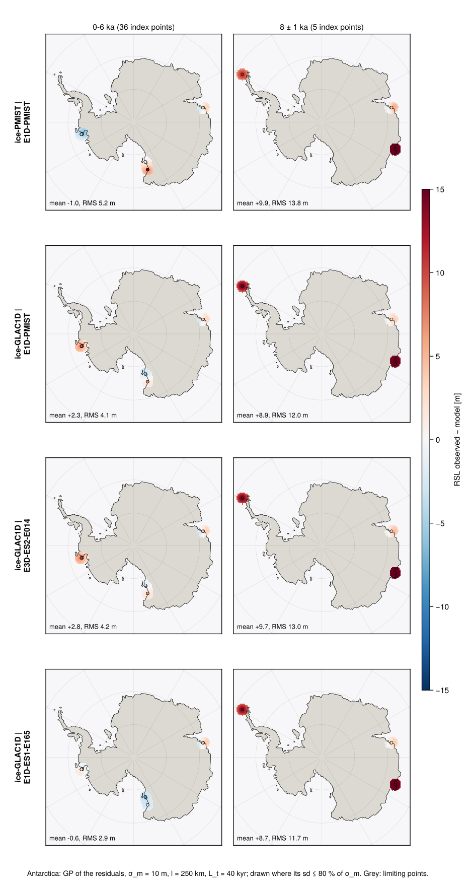

Where in space and time the simulations miss the data. Four simulations of imposed ice on VILMA2: the two published ice
histories on Gowan's Earth, `ice-PMIST | E1D-PMIST` and `ice-GLAC1D | E1D-PMIST` (I1 and I5 of [Results](results.md)),
and under GLAC-1D's ice the best 3-D Earth of the search, `ice-GLAC1D | E3D-ES2-E014`, and the best 1-D Earth of wave A,
`ice-GLAC1D | E1D-ES1-E165` ([The Earth search](earth-search.md)). The data, the model values and the error model are
those of the scores ([Data and scores](data-scores.md)). Status 2026-11-16.

## Maps from scattered data

The data are points, so the maps fill the space between them with a Gaussian process (GP), i.e. kriging. The kernel is
Matérn-3/2 on the chord distance, with longitude and latitude as 3-D vectors, which keeps it valid on the sphere. Each
point carries its own error σ_i as noise. A field is drawn only where the GP's sd is at most 80 % of its prior sd, i.e.
where the points constrain it; elsewhere the map shows land and ocean.

Two kinds of field:

- **The data alone** (GNSS): a constant mean and the GP's sd σ_f and length scale l by maximum marginal likelihood, per
  domain.
- **The residual**, observed − model: zero mean, with σ_m and the length of the error model of the scores. Model plus
  kriged residual is the field the data ask for: the residual map is the correction the data would make to the model,
  and only where they can.

GNSS in Greenland and Antarctica is reported, not judged: the elastic response, Little Ice Age loading and transient
rheology dominate there ([Data and scores](data-scores.md#data)). Their model error was never fitted, so their residual
GP has σ_m and l by maximum marginal likelihood over the four simulations together.

## GNSS uplift rates

Per domain: the stations over the GP mean of the data (top); per simulation the present-day uplift rate (the rate of bed
change at the run's last record, as scored) with the stations in their observed colours (left), and the residual at the
stations over its kriged field (right). One colour scale per figure. Red: uplift, or observed faster than modelled.

The two runs on Gowan's Earth and E165 rise faster than the stations over most of the domain (mean residual −2.0 to −3.1
mm/yr). E014 has no mean residual (+0.2 mm/yr) and the lowest RMS (2.4 against 3.5-4.1 mm/yr); what remains is positive
south-east of Hudson Bay.

Every run places the dome over the Gulf of Bothnia. E014's dome is narrower and lies further north-east: the stations of
southern Sweden and southern Norway rise faster than it (mean residual +1.0 mm/yr, RMS 1.7), where the other three are
within about 1 mm/yr (RMS 1.2-1.4).

All four runs subside where the stations rise, most on the west coast: the mean residual is +2.8 to +5.2 mm/yr. E014 is
the closest (RMS 3.8 mm/yr), GLAC-1D's ice on Gowan's Earth the furthest (5.7).

In every run the stations of the Amundsen Sea coast rise faster than modelled and those of the Antarctic Peninsula
slower. E014 has the largest uplift in the peninsula and the largest RMS (9.3 against 5.7-6.2 mm/yr).

## RSL residuals in time windows

Per RSL group: the residual at the index points (observed − model) over its kriged field, per time window (columns) and
simulation (rows). Windows of 8, 12 and 16 ± 1 ka, and 0-6 ka, where most of the data are; a window is shown when it
holds at least 5 index points of the group. The residual GP uses the group's error model of the scores, σ_m, l and its
time term exp(−|t − t_c|/L_t) at the window's mid age t_c. Limiting points (small, grey) are not kriged. Red: RSL
higher than modelled. Each panel gives the mean and RMS of the residuals at its points.

Where neighbouring points disagree, the smooth kernel can overshoot: in Greenland and Barents at 8 ka and the far field
at 0-6 ka the field reaches 10-30 m beyond the largest residual at the points.

From 0 to 6 ka the four runs fit within a few m (RMS 3.7-5.6 m), and in all four RSL lies below the model in the north
of the domain. At 8 and 12 ka the runs differ: PaleoMIST's ice is too high in the north and too low in the south; E014
and E165 have the smallest residuals at 8 ka (RMS 11.3 and 11.9 m), E165 at 12 ka (16.6 m).

At 8 ka west Greenland lies above the two runs on Gowan's Earth by tens of m (mean +24 and +40 m); E014 (+3 m) and E165
(+11 m) are close.

At 8 ka RSL lies below every run around the North Sea and the Gulf of Bothnia, under GLAC-1D's ice more (mean −7 to
−11 m, RMS 11.6-14.4 m) than under PaleoMIST's (−3.4 m, RMS 9.2 m).

From 0 to 6 ka every run fits within about 5 m RMS. At 12 ka all runs are too high (mean −13 to −73 m), E165 most.

Few data: from 0 to 6 ka the four runs fit within 3-5 m RMS; the 5 points at 8 ka lie above every run by about 9 m.

The far-field residual grows with age and is negative: RSL lies below the runs by 10-21 m on average at 12 and 16 ka,
least under PaleoMIST's ice. Most points are on the Great Barrier Reef and in Southeast Asia.

## RSL at sites

Per group three key sites (four in the far field): the ice centre, the margin, and the forebulge or the far field. Each
index point is a box of its age and RSL range, the limiting points open triangles (marine, RSL above: up; terrestrial,
RSL below: down), the four simulations lines. The PaleoMIST run has records every 2.5 kyr, the GLAC-1D runs every 100
yr. Where GAPSLIP 2.1 has no site at the place asked for, or fewer than about 8 index points, the nearest one stands in
(the site table `KEY_SITES` of the script).

## Reproducing the figures

`tools/levante/plastic_data_maps.jl` on albedo, the data and the error model of the Earth search's scoring folder
(`KRYOS_SCORE`, default `/albedo/work/user/alrobi001/kryos-search/score/ens`); output and job script in
`/albedo/work/projects/p_forclima/kryos-work/site-maps` (`out/maps.md`: the GP hyperparameters and the statistics of
every panel). The runs, as scored:

| simulation | folder |
|---|---|
| `ice-PMIST \| E1D-PMIST` | `/albedo/work/user/alrobi001/kryos-gnss/kryos_data/refcorr/ice-PMIST_E1D-PMIST` (it4; the rerun with `dz_bed_rate`) |
| `ice-GLAC1D \| E1D-PMIST` | `/albedo/work/user/alrobi001/kryos-work/kryos_data/refcorr/ice-GLAC1D_E1D-PMIST` (it4) |
| `ice-GLAC1D \| E3D-ES2-E014` | `/albedo/work/user/alrobi001/kryos-search/kryos_data/refcorr/ice-GLAC1D_E3D-ES2-E014/it0` (one pass, the r of its profile) |
| `ice-GLAC1D \| E1D-ES1-E165` | `/albedo/work/user/alrobi001/kryos-search/kryos_data/refcorr/ice-GLAC1D_E1D-ES1-E165` (it3) |
